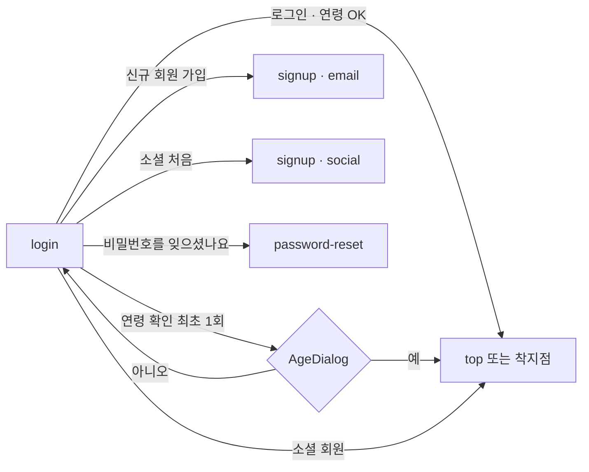

# login — UI-SPEC

- 화면 ID: `login`
- 상태: **기안** (§1~11 작성 2026-10-15 · **export 값으로 썼다** — 순서가 거꾸로다: 프롬프트 → Claude Design 1판 → 이 문서 · **UX승인 대기** — §11 의 결정 10건은 프롬프트의 기본값대로 만들어져 있다). **`template/` 2판 취임 2026-10-15**(12:51 · 상혁이 Claude Design 에서 결정 2건을 정한 판) — 검수 [UI-REVIEW](UI-REVIEW.md) 2차
- 담당: 디자이너 지수 ／ 문서 Claude Code
- 이 문서가 **인증 4화면의 틀**이다. `signup` · `password-reset` · `onboarding-survey` 는 이 문서와 다른 것만 적는다. template 도 한 장이다(`template/Auth.dc.html` · `screen`)

> 출처: Figma `zFWjJinW6NAtyMMzMujNl2` / **`1059:45794` 「온보딩(로그인/가입/설문)」(최신본)** — 로그인 구역 `1059:45795`(로그인 화면 `1059:46062` · 연령 확인 `1059:45796` · 모달 `1059:46032` · `46047` · 메모 `1059:46028` 「장기 미로그인 유저 대상 연령확인 모달」). **같은 이름의 `1045:30020` 은 이전 판이다**(비밀번호 찾기가 메일 링크 방식 · 비밀번호 변경이 아직 여기 있음). 판정 근거는 프롬프트 `design/_import/prompts/auth-1015.md` 표. 읽은 날 2026-10-15.

## 1. 화면의 사명

**들어오는 문이다.** 이메일이나 소셜 계정으로 로그인하고, 처음이면 가입으로, 비밀번호를 잊었으면 재설정으로 보낸다. 로그인 성공 직후 만 14세 확인을 한 번 한다.

## 2. 대상 사용자와 상황

| 누가 | 언제 | 무엇을 원하나 |
|---|---|---|
| 돌아온 회원 | 비로그인으로 도움돼요 · 스크랩 · 신청을 눌렀을 때 · 헤더의 「로그인」 | 빨리 들어가서 하던 일로 |
| 처음 온 사람 | 헤더의 「회원가입」 · 로그인 화면의 「신규 회원 가입」 | 소셜로 간단히, 또는 이메일로 |
| 비밀번호를 잊은 회원 | 로그인 실패 뒤 | 메일로 인증하고 바로 새 비밀번호 |
| 장기 미로그인 회원 | 오랜만의 로그인 | 연령 확인 한 번(와이어 메모) |

## 3. 액션 방침

| 판정 조건 | 아크션 |
|---|---|
| **이메일 · 비밀번호 두 칸이 찼다** | 「로그인」이 켜진다. 비면 disabled |
| 로그인이 틀렸다 | 두 칸 테두리 `--destructive` ＋ 비밀번호 칸 아래 「이메일 또는 비밀번호가 맞지 않습니다.」(와이어에 없음 · 창조) |
| 로그인에 성공했는데 연령 확인을 한 적이 없다 | `AgeDialog` 를 한 번 띄운다. 「예」 → 착지점 ／ 「아니오」 → 이용 불가 안내 뒤 로그아웃(§11 1) |
| 소셜 버튼을 눌렀다 | 소셜 인증 → 처음이면 `signup?mode=social`(이름 ＋ 동의) · 회원이면 착지점 |
| 「비밀번호를 잊으셨나요?」 | `password-reset` |
| 「신규 회원 가입」 | `signup?mode=email` |
| **링크는 전부 같은 탭** | `target="_blank"` 없음(상혁 2026-10-14 · 전 화면 공통) |

## 4. 구성과 하이어라키

**로고만 있는 헤더 ＋ 가운데 세로 기둥(폭 400) ＋ 푸터 없음**(`AuthShell`). 인증 4화면이 같은 셸이다.

| 순 | 블록 | 안 |
|---|---|---|
| 1 | 헤더 | **로고만 있는 띠**(`DS-123` 조립 · 4판). 안쪽 상자는 다른 화면의 헤더와 같은 컨테이너(1280 · 좌우 `--container-pad`)라 로고가 x 104(768 이하 16)에 선다. 높이 64 ＋ 아래 1px `--border`(65) · 흰 78% ＋ 블러 12 · 스크롤에 붙는다(sticky). 메뉴 · 버튼 · 푸터 없음. **로그인 화면은 띠째 숨긴다** — 가운데 로고 48 이 대신한다(상혁 CD 결정 2026-10-15 · 3판에서 빈 띠까지 없앴다) |
| 2 | 머리 | 로고 48 가운데 → h0 「멘트리에 어서오세요.」 가운데 |
| 3 | 이메일 로그인 | `Field` 「이메일」 → `Field` 「비밀번호」(눈 토글 · 4판에서 라벨을 달았다) → 오른쪽 정렬 글자 링크 「비밀번호를 잊으셨나요?」 |
| 4 | 버튼 | `primary` lg 100% 「로그인」 → `outline` lg 100% 「신규 회원 가입」(둘 다 48 · 4판) |
| 5 | 구분 | 1px 선 ＋ 가운데 「또는」 |
| 6 | 소셜 | caption 「소셜 계정으로 시작하기」 → 가로 3 `outline` 「구글」 「네이버」 「카카오」. 왼쪽에 브랜드 로고 20(구글 G 4색 · 네이버 N · 카카오 말풍선) · 글자와 간격 8 |
| — | `AgeDialog` | `Dialog` 520 · 제목 「만 14세 이상이신가요?」 · 본문 · 「? 개인정보 처리 방침」 · `RadioGroup` 2 · 바닥 `primary` 100%(고르기 전 「연령 확인 버튼을 선택해주세요」 disabled → 「확인」) |

**띠가 있는 화면**(가입 · 재설정 · 설문 · 완료)의 본문 위 여백은 40(768 이하도 40 · 4판). 로그인은 PC 64.

**768 이하**: 기둥 100% · 좌우 16 · 로그인 위 여백 32 · 소셜 3개는 가로 그대로(각 1/3) · 모달 전체 화면.

## 5. 적용 패턴 (P-nn)

| 패턴 | 적용 |
|---|---|
| `P-06` 되돌릴 수 없는 것은 한 번 묻는다 | 연령 「아니오」 확인 → 로그아웃 |
| `P-08` 입력 상한과 카운터 | 비밀번호 규칙 caption(영문 · 숫자 · 특수문자 8자 이상)은 가입 · 재설정에서 |
| 승격 후보 | **「인증 4화면의 셸」**(로고 헤더 ＋ 기둥 400) — 4화면이 같다. UX승인 뒤 `UX-PATTERNS` 로 |

## 6. 블록별 규칙 (구성 요소 포함)

| 블록 | DS 부품 | 값 · 규칙 |
|---|---|---|
| 셸 | `Header` 아님 — 로고만 있는 띠 조립(`data-temp="DS-123"`) | 안쪽 상자 `--container-max` · `--container-pad` · 높이 64 ＋ 선 · 흰 78% ＋ 블러 12 · sticky · 로고 24 높이. 로그인에서는 `hide-header` 로 띠째 숨김 |
| 입력 | `Field` ＋ `Input` · 비밀번호는 `type=password` ＋ `IconButton ghost`(view / view-off) | 라벨 「이메일」 · 「비밀번호」(16/600). 로그인 실패 문장은 비밀번호 칸의 `Field error` |
| 버튼 | `Button primary lg fullWidth` · `outline lg` — 화면의 주 버튼은 48(기준 화면과 같다). 소셜 3 · 인증 번호 칸 옆 · 약관 닫기는 md | 두 칸이 차야 `primary` 활성 |
| 글자 링크 | `Button ghost sm tone="primary"` | 「비밀번호를 잊으셨나요?」 · 문장 끝 「로그인」 · 「톱 화면으로 가기」. 여는 ghost(「내용보기」 · 「프로필 이미지 등록하기」)도 초록 |
| 소셜 | `Button outline md fullWidth` × 3 ＋ 인라인 SVG 로고 20 | 바탕은 DS outline 그대로(브랜드 색 바탕이 아니다 · 상혁 CD 결정 2026-10-15). 로고 색만 브랜드 가이드. 로고는 `aria-hidden` · 버튼 이름은 글자 |
| 연령 모달 | `Dialog` · `RadioGroup` · `Button` | 「아니오」 뒤 본문 「만 14세 미만은 멘트리를 이용할 수 없습니다. 보호자와 함께 다시 방문해주세요.」 ＋ `outline` 「닫기」 |
| 토스트 | `Toast` | 로그인 실패는 토스트가 아니라 칸 아래 글자(§3) |

## 7. 상태 목록

| 상태 | 주소 | 무엇이 보이나 |
|---|---|---|
| normal | `screen=login` | 빈 칸 · 「로그인」 disabled |
| filled | `state=filled` | 김민지 표본 · 「로그인」 활성 |
| error | `state=error` | 두 칸 destructive ＋ 문구 |
| age | `state=age` | 로그인 성공 직후 `AgeDialog` 열림 · 바탕 흐림 |
| age-no | `state=age-no` | 「아니오」 뒤 안내 |
| loading | — | 버튼 안 스피너(`Button loading`). 별 화면 없음 |

## 8. 표시·활성 제어의 판정 조건과 아크션

| 판정 조건 | 아크션 |
|---|---|
| 두 칸 중 하나라도 비었다 | 「로그인」 disabled |
| 눈 아이콘을 눌렀다 | 비밀번호를 보인다 ／ 숨긴다(`show`) |
| 연령 모달에서 아무것도 안 골랐다 | 바닥 버튼 disabled · 글자 「연령 확인 버튼을 선택해주세요」 |
| 「예」를 골라 확인했다 | 모달 닫힘 → 착지점(§11 10) |
| 「아니오」를 골라 확인했다 | 본문이 이용 불가 안내로 바뀜 → 「닫기」 → 로그아웃된 로그인 화면 |
| 768 이하 | 기둥 100% · 모달 전체 화면 |

## 9. 화면 전이

- **착지점은 미결**([screen-inventory](../../docs/screen-inventory.md) 「로그인 후 착지점」 · [transition-map](../../docs/transition-map.md) 미결 4). 지금은 TOP.
- 비로그인 천이도는 Figma `1065:80793` 이 정본이다. 여기에 옮겨 그리지 않는다.

## 10. 의존 API

| 무엇 | 계약 |
|---|---|
| 이메일 로그인 · 소셜 로그인 3(구글 · 네이버 · 카카오) | **계약 미정의.** 엔지니어 소관 |
| 연령 확인 기록(최초 1회 · 장기 미로그인 재확인) | **계약 미정의** |
| 착지점(`next`) | 미결 |

## 11. 미결 사항 — 인증 4화면 공통

전부 프롬프트의 기본값으로 template 이 만들어져 있다. 화면을 보고 OK/NG 로 닫는다.

| # | 무엇 | 기본값(template) | 다른 길 | 언제 걸리나 |
|---|---|---|---|---|
| 1 | **연령 확인 모달의 때** | 로그인 성공 직후 1회 · 「아니오」면 안내 뒤 로그아웃(와이어 메모 「장기 미로그인 유저 대상 · 최초 1번」) | 가입의 「만 14세 이상」 체크로 갈음 · 모달 없음 | 사업 · UX승인 |
| 2 | **소셜 최초 로그인 뒤** | 이름 ＋ 동의 → 설문 1스텝 | 설문 건너뛰고 TOP | UX승인 |
| 3 | **설문 건너뛰기** | 매 스텝 허용 · 완료 화면은 간다(메모 Q2) | 1스텝 필수 | UX승인 |
| 4 | **사진 트리밍** | DS `ImageCropper`(메모 「1.0 의 트리밍 활용?」) | 1.0 방식 — 부품 없음 | UX승인 |
| 5 | **가입 완료의 첫 액션** | 「톱 화면으로」 하나(와이어) | 「맞춤 멘토 보기」 넛지(메모) — 착지점과 같이 | 사업 |
| 6 | **인증 횟수 제한** | 24시간 5회 · 재전송 5분 뒤(보드 메모) | 제한 없음 | 사업 |
| 7 | **비밀번호 규칙** | 영문 · 숫자 · 특수문자 8자 이상(마이페이지와 같음) | 다른 규칙 | 사업 |
| 8 | **일러스트** | 초록 원 ＋ 아이콘(와이어의 그림 3장 대신) | 지수가 그림을 넣는다 | 디자이너 |
| 9 | **로그인 실패 문구** | 「이메일 또는 비밀번호가 맞지 않습니다.」 | — | UX승인 |
| 10 | **로그인 후 착지점** | TOP | 가입을 시작한 자리로 | UX승인 — 화면 목록 미결 |
| 11 | ~~소셜 버튼의 브랜드 로고~~ | — | **2판에서 닫힘**(상혁 요청 2026-10-15) — 로고 3종 · DS outline | — |
| 12 | ~~**인증 화면 맨 위**~~ — **4판에서 닫힘**(상혁이 추천값대로 돌렸다 2026-10-15). 기준 화면(톱 · Q&A · 인사이트 · 멘토 상세)과 일원화할 때 | 로고만 있는 띠를 두고 헤더와 자리(로고 x 104) · 높이 · 바탕을 맞춘다. 공용 `Header` 에 로고만 형태가 없어 `DS-123` | 전체 헤더 ＋ 푸터 ＋ 모바일 하단 탭 | 상혁 — 3차 프롬프트 `auth-r3-1015.md` 에 추천값으로 넣었다 |
| 13 | ~~**로그인 칸 라벨**~~ — **4판에서 닫힘**(라벨을 달았다) | 「이메일」 · 「비밀번호」 라벨을 칸 위에 단다(기준 화면의 입력은 전부 라벨이 있다) | 와이어대로 자리글만 | 상혁 — 같은 프롬프트에 추천값으로 넣었다 |

**2판에서 상혁이 Claude Design 으로 정한 2건**(2026-10-15) — ① 로그인 화면의 로고는 와이어 쪽(헤더 로고 숨김 · 가운데 로고 48 하나). ② 소셜 버튼은 DS outline ＋ 브랜드 로고(브랜드 색 바탕을 쓰지 않는다).

## 실행 계획

- [x] 와이어를 읽고 최신 판을 판정한다 (2026-10-15 · `1059:45794`)
- [x] 프롬프트 `design/_import/prompts/auth-1015.md` (2026-10-15)
- [x] `template/` 1판 취임 — export 10-15 12:26 · SHA `e681a51f4616` (2026-10-15)
- [x] §1~11 을 export 값으로 쓴다 (2026-10-15) — **UX승인 대기**(§11 10건)
- [x] 검수 1차 `UI-REVIEW.md` (2026-10-15)
- [x] 2차 export(소셜 로고 외) 취임 · 검수 2차 (2026-10-15 · 2판 12:51 · SHA `cec0fba6b536` · 1차 5건 결착)
- [ ] 남은 것 2건(로그인의 빈 헤더 띠 · 인증 칸 자리글 말줄임) — 다음에 Claude Design 을 만질 때
- [ ] 승격 후보 「인증 4화면의 셸」을 `UX-PATTERNS.md` 로 — UX승인 뒤
