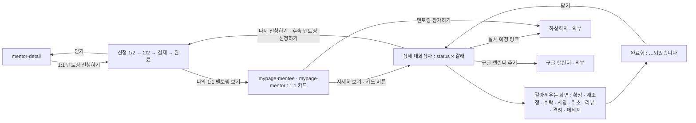

# mentoring-apply: 멘토링 신청 · 1:1 멘토링 상세 — 신청 · 수락 · 확정 · 완료의 흐름

- 상태: **기안** (§1~11 작성 2026-10-20 · **UX승인 대기** — §11 의 미결 8건. 범위 결정은 상혁이 정했다 2026-10-20). **`template/` 3판 취임 2026-10-20** — 검수 [UI-REVIEW](UI-REVIEW.md)
- 화면 구분: 작업
- 템플릿: [`template/`](template/SOURCE.md) — 3판(2026-10-20 13:15 · `Mentree 2.0 Mentoring Flow`)

> **정본은 Figma `zFWjJinW6NAtyMMzMujNl2` 의 섹션 `1059:31880` 「멘토링 신청 / 확정 Flow」다**(상혁 2026-10-19 「이게 최신본」). 멘티 쪽 「멘토링 신청 Flow」 `1059:31881` · 멘토 쪽 「멘토링 수락 Flow」 `1059:33275`. 정본의 53개 상태 전부가 3판 `template/` 에 있다([UI-REVIEW](UI-REVIEW.md)).
>
> **이 사양이 맡는 범위**(상혁 결정 2026-10-20). ① 멘티의 신청 페이지 ② 1:1 멘토링 카드를 누른 뒤에 뜨는 대화상자 전부 — 상세 · 일정 확정 · 재조정 · 수락 · 사양 · 취소 · 리뷰 · 격려 · 취소 뒤 메세지, 두 역할. **마이페이지는 카드 목록까지만 맡는다**([mypage-mentee](../mypage-mentee/UI-SPEC.md) §6 3 · 카드 버튼 → 이 화면의 대응표). 화면 목록의 19 · 20 「멘토링 상세」 모달은 이 사양의 §6 이다.

---

# 1부 — UX 설계 의도 (§1~5)

## 1. 화면의 사명

멘티가 멘토에게 1:1 멘토링을 신청하고, 두 사람이 일정을 맞춰 확정하고, 끝난 뒤 리뷰와 격려를 주고받는 **한 흐름**이다. 어느 자리에서 열어도 3초 안에 「이 멘토링은 어디까지 왔고, 지금 내가 할 일은 무엇인가」에 답한다.

## 2. 대상 사용자와 상황

- 대상 사용자: **멘티**(신청 · 일정 확정 · 재조정 요청 · 취소 · 리뷰) · **멘토**(수락 ＝ 일정 제안 · 사양 · 일정 재조정 · 취소 · 격려 메세지 · 취소 뒤 메세지). 멘토도 멘티가 된다([transition-map](../../docs/transition-map.md) §3)
- 상황: ① 멘토 상세의 「1:1 멘토링 신청하기」 ② 마이페이지 1:1 카드의 버튼 · 「자세히 보기」 ③ 알림 · 메일의 「자세히 보기」(URL 은 미결 §11 4)
- 이용 패턴: 필요할 때만. 멘토링 1건에 4〜6번 들어온다 — 신청 → 확정 → 참가 → 리뷰

## 3. 액션 방침

- 주 액션: **상태마다 하나.** 멘티는 신청 · 일정 확정하기 · 리뷰 작성하기. 멘토는 멘토링 수락하기(일정 제안) · 일정 재조정하기 · 격려 메세지 작성하기
- 부 액션: 멘토링 취소하기 · 일정 재조정 요청하기 · 사양하기 · 멘티에게 메세지 보내기 · 구글 캘린더 추가 · 링크 복사하기 · 다시 신청하기 · 후속 멘토링 신청하기
- **이 화면에서 하지 않는 것**: 대화상자를 겹치지 않는다 — 같은 대화상자의 화면을 갈아끼운다. 결제 수단의 입력은 결제사 모듈에 맡긴다(§11 1). **상세 대화상자에 「멘토링 참가하기」를 두지 않는다** — 정본에 없고, 카드의 버튼과 확정 블록의 링크가 그 일을 한다. 멘토링 목록 · 탭은 그리지 않는다(마이페이지)

## 4. 구성과 하이어라키

**신청은 페이지, 그 뒤는 대화상자 하나다.**

- **신청 페이지** — 가운데 기둥 640. 위에 「< 박멘토 멘토 상세로」 · 진행 막대 2단계(`StepBar` · `DS-121`) · 1/2 신청 → 2/2 꽃 선물 → 결제 → 완료 대화상자. 결제사 화면을 다녀와야 하므로 모달보다 페이지가 단단하다(2026-09-10 · [screen-inventory](../../docs/screen-inventory.md) 「모달인가 화면인가」). 와이어는 모달로 그렸으나 1.0 의 답습이다
- **상세 대화상자**(폭 640) — 위에서 아래로 「지금 상태 → 할 일의 재료 → 할 일」. ① 상태 문장 ② 메세지 상자(있을 때) ③ 확정 블록(확정 뒤) ④ 상대 정보 ⑤ 정의 목록(신청일 · 유형 · 제목 · 요청 상세 · 시간 · 일정 조율 요청사항 · 꽃송이 · 작성한/작성된 리뷰) ⑥ 바닥 버튼
- **갈아끼우는 화면** — 상세의 버튼이 여는 일(확정 · 재조정 · 수락 · 사양 · 취소 · 리뷰 · 격려 · 메세지)은 같은 대화상자의 화면으로 바뀐다. 「…되었습니다」 완료형으로 끝나고 「닫기」로 상세에 돌아온다
- **대화상자 뒤**에는 회색 바탕 위에 그 상태의 멘토링 카드 1장(마이페이지 카드와 같은 부품)을 둔다. 카드의 버튼을 누르면 위 화면이 열린다. 마이페이지에서 열릴 때의 모습 그대로다

## 5. 적용 패턴 (P-nn)

| 패턴 | 이 화면에서의 적용 |
|---|---|
| `P-02` 빈 상태의 다음 행동 | 신청 화면을 못 불러왔다 → `EmptyState` ＋ outline 「다시 시도하기」 |
| `P-09` 묻지 않고 실행취소 | **쓰지 않는다.** 취소 · 사양은 비가역이라 확인한다 |
| 편집형 대화상자 — `Dialog` 520 · `footerLayout="stack"` · 모바일 fullscreen(마이페이지 3판과 같다) | 일정 확정 · 재조정 요청 · 수락 · 사양 · 재조정 · 취소(사유) · 리뷰 작성 · 격려 작성 · 메세지 작성 |
| 확인형 대화상자 — `Dialog` 420 · `footerLayout="end"` · 모바일 가운데 카드 | 신청 취소(수락 전) · 신청 중 떠날 때 |
| 완료형 대화상자 — 원 120(`--green-50`) 안 아이콘 48 ＋ 제목 ＋ 안내 ＋ stack | 신청 · 확정 · 수락 · 재조정 · 취소 · 리뷰 · 격려 전송 · 메세지 전송의 완료 |
| 승격 후보 — **카드 ↔ 대화상자의 「상태 문장 ＋ 할 일 버튼」 짝** | 마이페이지 카드와 이 상세가 같은 문장 · 같은 버튼 이름을 쓴다. 다른 흐름(Q&A 답변)에서 같은 판단이 나오면 `UX-PATTERNS` 로 올린다 |

버튼 variant 계층 · 그림자 · 카드 안 액션 구성은 디자인 시스템을 따른다(`design/DESIGN.md`).

---

# 2부 — 구조 (§6~11)

## 6. 블록별 규칙 (구성 요소 포함)

주소 값은 [`template/SOURCE.md`](template/SOURCE.md) 의 표다. `screen` 은 화면, `status` 는 멘토링 상태, `cancelBy` · `reply` · `review` · `cheer` 는 완료 · 취소의 갈래.

### 신청 페이지 — 멘티 · `screen=apply-1` → `apply-2` → `apply-pay` → `apply-done`

| 요소명(English) | 종류 | 내용 | 이 화면에서의 규칙 |
|---|---|---|---|
| `StepBar` | 진행 막대 | 2단계 · 「1/2」 「2/2」 | `DS-121` 조립(온보딩 설문과 같다). 결제 · 완료는 2/2 에 속한다 |
| `ApplyForm`(1/2) | 폼 | 멘토링 유형 ＊ `Select` · 제목 ＊ `Input` limit 40 · 상세 내용 ＊ `Textarea` limit 1000 rows 8 · 시간 ＊(30분 · 1시간) · 일정 조율 정보 ＊ `Textarea` limit 200 | 유형의 선택지는 **그 멘토가 「이런 고민을 도와드려요」에 올린 키워드**다. 시간 아래 「이 멘토의 멘토링 최소 금액 : 30분당 2송이(4만원)」. 필수 5칸이 다 차야 「다음 단계로」가 켜진다 |
| `FlowerForm`(2/2) | 폼 | 안내 3줄 ＋ 「과금/환불 규정에 대하여」 · 쿠폰 `Input` ＋ outline 「쿠폰 코드 적용」 · 꽃송이 수 ＊ `Select` · 결제할 금액 | 송이 선택지는 **최소(30분 2송이 · 1시간 4송이)부터 20송이**. 금액은 고르기 전 muted 「미정」, 고르면 「n송이 × 2만원 = n원」(쿠폰이 있으면 할인 줄 ＋ 합계). 쿠폰은 적용 「쿠폰이 적용되었습니다 — n원 할인」 ／ 실패 `Field error` 「사용할 수 없는 쿠폰 코드입니다」. 「< 이전 화면으로」로 돌아가도 1/2 입력은 남는다 |
| `PaymentSlot` | 결제 모듈 자리 | 반경 `--radius-lg` 빈 상자 420 · 「결제 모듈 UI」 | `data-temp="PG"`. 결제사가 정해지면 바뀐다(§11 1) |
| `ApplyDoneDialog` | 완료형 | 「멘토링 신청이 성공적으로 완료되었습니다.」 · 안내 「[마이페이지 > 나의 1:1 멘토링] … 매칭되지 않은 멘토링은 7일 후 자동으로 취소됩니다.」 | 바닥 primary lg fullWidth 「나의 1:1 멘토링 보기」 ＋ ghost 「닫기」(멘토 상세로) |
| `LeaveConfirm` | 확인형 | 「작성 중인 신청서가 있어요」 · 「나가면 입력한 내용이 사라집니다.」 | 입력이 있는 채로 헤더 · 「< 멘토 상세로」를 누를 때. [돌아가기 · 나가기] |

### 상세 대화상자 — 공통 틀 · `screen=detail` (마이페이지 카드의 「자세히 보기」)

`Dialog` 640 · 제목 「1:1 멘토링 신청 내용」. 모바일은 전체 화면.

| 요소명(English) | 종류 | 내용 | 이 화면에서의 규칙 |
|---|---|---|---|
| `StatusSentence` | 상태 문장 | 카드의 상태 줄과 **같은 문장**(아래 멘티 · 멘토 표) | `--primary` · 가운데. 상태가 바뀌면 이 문장만 바뀐다 |
| `MessageBox` | 상자 | 「멘토로부터의 메세지」 · 「멘티로부터의 메세지」 · 「멘토에게 보낸 메세지」 · 「멘티에게 보낸 메세지」 · 「일정 재조정 요청사항」 | 있는 것만, 받은 것 → 보낸 것 순서. `--green-50` · 라벨 caption 600 `--green-900` |
| `FixedBlock` | 확정 블록 | 「멘토링 실시 예정 시간」 ＋ 「멘토링 실시 예정 링크」 | 확정 뒤에만. 아래 「확정 블록」 |
| `PersonCard` | 상대 정보 | 멘티 정보 ／ 멘토 정보 — `Avatar` 56 ＋ 이름 ＋ `Flag` ＋ 「직함 · 소속」 ＋ > | `DS-119`. 누르면 멘토 상세(멘티 쪽) ／ 멘티 프로필(멘토 쪽 · 마이페이지 팔로워 모달과 같은 내용) |
| `DefinitionList` | 정의 목록 | 멘토링 신청일 · 유형 · 제목 · 요청 상세 내용 · 시간 · 일정 조율 요청사항 · 꽃송이 | 완료 뒤에는 첫 줄이 「멘토링 실시일」. 꽃송이 라벨: 멘티 「선물 예정 꽃송이」 → 완료 「선물한 꽃송이」 ／ 멘토 「선물받을 꽃송이」 → 완료 「선물받은 꽃송이」. 리뷰가 있으면 맨 끝에 「작성한 리뷰」(멘티) ／ 「작성된 리뷰」(멘토 · 없으면 muted 「아직 작성된 리뷰가 없습니다.」) |
| `Footer` | 바닥 | 상태별 버튼(아래 표) | `stack` — 첫 버튼 primary lg **fullWidth 를 직접 넘긴다**(`DS-124`) · 둘째 outline lg ／ 글자 버튼은 ghost sm |

### 멘티 화면 — 상태 × 문장 × 바닥

| `status` | 상태 문장 | 바닥(위 → 아래) | 여는 화면 |
|---|---|---|---|
| `applied` | 멘토의 수락을 기다리는 중입니다. | 멘토링 취소하기 | `cancel`(확인형) |
| `scheduling-received` | 멘토가 멘토링을 수락했습니다. 일정을 확정해주세요. | **일정 확정하기** · 멘토링 취소하기 | `fix-schedule` · `cancel` |
| `rescheduled` | 멘토가 새 일정을 제시했습니다. 일정을 확정해주세요. | 같다 | 같다 |
| `rescheduled-by-mentor` | 멘토가 일정 재조정을 요청했습니다. ＋ 「멘토로부터의 메세지」 | 같다 | 같다 |
| `reschedule-requested` | 멘토에게 일정 재조정을 요청했습니다. ＋ 「일정 재조정 요청사항」 | 멘토링 취소하기 | `cancel` |
| `fixed` · `fixed-24h` | 멘토링이 확정되었습니다. 2026.10.14 (수) 18:00에 멘토링이 진행됩니다. ＋ 확정 블록 | **일정 재조정 요청하기** · 멘토링 취소하기 | `reschedule-request`(현재 예정일을 보여 준다) · `cancel` |
| `done` · `review=0` | 멘토링이 완료되었습니다. 리뷰를 작성해주세요. ＋ `cheer=1` 이면 「멘토로부터 격려 메세지가 도착했습니다.」 상자 | **리뷰 작성하기** · (`cheer=1`) 격려 메세지 보기 | `review` · `cheer-read` |
| `done` · `review=1` | 멘토링이 완료되었습니다. ＋ 격려 상자 ＋ 「작성한 리뷰」 칸 | **후속 멘토링 신청하기** · (`cheer=1`) 격려 메세지 보기 | `apply-1` · `cheer-read` |
| `cancelled` · `cancelBy=me` | 나의 요청에 의해 취소되었습니다. ＋ 「멘토에게 보낸 메세지」 ＋ (`reply=1`) 「멘토로부터의 메세지」 | **다시 신청하기** | `apply-1` |
| `cancelled` · `cancelBy=other` | 멘토의 사정에 의해 취소되었습니다. 멘토로부터 메세지가 도착했습니다. ＋ 「멘토로부터의 메세지」 | 다시 신청하기 | `apply-1` |
| `cancelled` · `cancelBy=noshow` | 멘토링이 예정대로 실행되지 않아서 취소되었습니다. ＋ (`reply=1`) 「… 멘토로부터 메세지가 도착했습니다.」 ＋ 상자 | 다시 신청하기 | `apply-1` |

**갈아끼우는 화면 — 멘티.**

| `screen` | 틀 | 안 | 바닥 |
|---|---|---|---|
| `fix-schedule` 멘토링 일정 확정하기 | 편집형 | 「멘토가 제시한 일정중에 하나를 선택해 멘토링을 확정해주세요. 만약 맞는 일정이 없을 경우 [일정 재조정하기] 버튼을 눌러주세요.」 · 시간대 2줄(나의 · 멘토) · 달력(멘토가 낸 날만) · 「YYYY년 M월 D일 (요일)의 가능한 시간」 칩(하나만) · 「선택한 시간」 ＋ muted 「멘토 시간대 : …」 | **일정 확정하기**(시간을 골라야 켜짐) · ghost 「일정 재조정하기」 |
| `fix-done` | 완료형 | 「1:1 멘토링 일정이 확정되었습니다.」 ＋ 확정 블록 ＋ 안내 「[마이페이지 > 나의 1:1 멘토링] 화면에서 자세한 일정과 접속 링크를 확인할 수 있습니다.」 | 닫기 |
| `reschedule-request` 멘토링 일정 재조정 요청 | 편집형 | 확정 뒤면 「현재 확정된 멘토링 예정일」 ＋ `Field` ＊ 「멘토링 일정 재조정을 위한 요청사항을 입력해주세요.」 `Textarea` 200 · 자리글 「적합한 요일, 시간 등의 요청 내용을 적어주세요.」 | **재조정 요청 보내기** · ghost 「< 이전 화면으로」 |
| `reschedule-sent` | 완료형 | 「일정 재조정 요청이 완료되었습니다.」 ＋ 「일정 재조정 요청사항」 상자 ＋ 「멘토링 일정 재조정 요청을 보냈습니다. 멘토가 새로운 일정을 제시할 때까지 조금만 기다려주세요.」 | 닫기 |
| `cancel` · `applied` | 확인형 | 「멘토링 신청을 취소하시겠습니까?」 · 「취소 시 선물할 예정인 꽃송이 값은 결제 수수료(3.4%)를 제하고 환불됩니다. 작성된 1:1 멘토링의 신청 내용은 모두 삭제됩니다.」 | [돌아가기 · destructive 신청 취소하기] |
| `cancel` · 조율 중 | 편집형 | 「멘토링을 정말 취소하시겠습니까?」 · 「멘토에게 취소 사유를 설명해주세요. 멘토가 제시한 일정을 맞추기 어렵다면 일정 재조정 요청도 가능합니다. 취소 시 … 3.4% …」 · `Field` 「멘토링 취소 사유」 200 | destructive **멘토링 취소하기** · ghost 「취소 사유 생략하기」 |
| `cancel` · `fixed` | 편집형 | 「확정된 멘토링을 정말 취소하시겠습니까?」 · 「멘토링을 준비하고 있을 멘토에게 취소 사유를 설명해주세요. 예정된 멘토링 일정을 맞추기 어렵다면 일정 재조정 요청도 가능합니다. 취소 시 … 3.4% …」 | 같다 |
| `cancel` · `fixed-24h` | 편집형 | 같은 제목 · 「멘토링 예정시간까지 24시간도 채 남지 않았습니다. 멘토링을 준비하고 있을 멘토에게 취소 사유를 설명해주세요. 멘토링 직전의 취소이므로 환불이 되지 않는 점 양해 부탁드립니다.」 | 같다 |
| `cancel-done` | 완료형 | 수락 전 「멘토링 신청이 취소되었습니다.」 ／ 그 밖 「멘토링이 취소되었습니다.」 ＋ 사유를 썼으면 「멘토에게 보낸 메세지」 | 닫기 |
| `review` 리뷰 작성하기 | 편집형 | 「이번 멘토링의 리뷰를 작성해주세요. 감사의 마음을 담은 정성스러운 리뷰는 멘토에게 큰 힘이 됩니다.」 · `Field` ＊ 「전반적인 멘토링 내용은 어땠나요?」 `Textarea` 1000 · `Field` 「특별히 인상깊었던 부분이 있다면 적어주세요」 1000 | **리뷰 작성하기**(첫 칸을 채워야) · ghost 「< 이전 화면으로」 |
| `review-done` | 완료형 | favourite 아이콘 · 「리뷰 작성이 완료되었습니다.」 · 「이 멘토에게 후속 멘토링을 의뢰하고 싶다면 [후속 멘토링 신청하기]를 눌러주세요」 | **후속 멘토링 신청하기** · ghost 닫기 |
| `cheer-read` 격려 메세지 | 읽기 | 「멘토로부터 격려 메세지가 도착했습니다.」 · 원 ＋ 아이콘 · 본문 상자 | 닫기 |

### 멘토 화면 — 상태 × 문장 × 바닥

| `status` | 상태 문장 | 바닥 | 여는 화면 |
|---|---|---|---|
| `applied` | 멘티로부터 멘토링 신청이 도착했습니다. | **멘토링 수락하기** · ghost 사양하기 | `accept` · `decline` |
| `scheduling-sent` · `rescheduled` | 멘티에게 일정 조율 요청을 보냈습니다. | 멘토링 취소하기 | `cancel` |
| `reschedule-requested` | 멘티로부터 일정 재조정 요청이 도착했습니다. ＋ 「일정 재조정 요청사항」 | **일정 재조정하기** · 멘토링 취소하기 | `reschedule` · `cancel` |
| `fixed` | 멘토링이 확정되었습니다. 2026.10.14 (수) 10:00에 멘토링이 진행됩니다. ＋ 확정 블록(멘티 시간대 병기) | **일정 재조정하기** · 멘토링 취소하기 | `reschedule`(사유 필수) · `cancel` |
| `done` · `cheer=0` | 멘토링이 완료되었습니다. 격려 메세지를 작성해주세요. ＋ 「작성된 리뷰」 칸 | **격려 메세지 작성하기** | `cheer-write` |
| `done` · `cheer=1` | 멘토링이 완료되었습니다. ＋ 「작성된 리뷰」 칸 | 보낸 격려 메세지 보기 | `cheer-view` |
| `cancelled` · `cancelBy=me` | 나의 요청에 의해 취소되었습니다. ＋ 「멘티에게 보낸 메세지」 | 없음 | |
| `cancelled` · `cancelBy=other` | 멘티의 사정에 의해 취소되었습니다. ＋ 「멘티로부터의 메세지」 ＋ (`reply=1`) 「멘티에게 보낸 메세지」 | `reply=0` 이면 **멘티에게 메세지 보내기** ／ `reply=1` 이면 없음 | `cancel-msg-write` |
| `cancelled` · `cancelBy=noshow` | 멘토링이 예정대로 실행되지 않아서 취소되었습니다. ＋ (`reply=1`) 「멘티에게 보낸 메세지」 | 같다 | 같다 |

**메세지를 보낸 뒤 버튼을 지운다**(정본 메모 `1059:34156` 「메세지 이미 보낸 경우에는 [멘티에게 메세지 보내기] 버튼 삭제」). 보낸 글은 상세의 상자에 남는다. 마이페이지 3판의 「작성한 메세지 보기」 버튼은 이 결정으로 없어졌다(2026-10-20).

**갈아끼우는 화면 — 멘토.**

| `screen` | 틀 | 안 | 바닥 |
|---|---|---|---|
| `accept` 멘토링 일정 조정하기 | 편집형 | 「멘토링 일정을 조정하기 위해 진행 가능한 날짜를 최소 3일 이상 선택해주세요. 제시한 후보 중 하나를 멘티가 선택하면 멘토링 일정이 확정됩니다.」 · 「일정 조정 요청사항」 상자(멘티의 글) · 시간대 2줄(멘토 · 멘티) · 「멘토링 가능 일정 선택」 ＋ ghost 「리셋하기」 · 안내 「원활한 스케줄 조정을 위해 최소 3일 이상의 날짜와 시간대를 선택해주세요.」 · 달력(여러 날) ＋ 날마다 시간 칩(여러 개) | **일정 제안 보내기**(3일 이상 · 날마다 1개 이상이어야 켜짐) · ghost 「< 이전 화면으로」 |
| `accept-done` | 완료형 | 「멘토링 수락이 완료되었습니다.」 ＋ 「[마이페이지 > 나의 1:1 멘토링 > 신청받은 1:1 멘토링] 화면에서 진행 상황을 확인하실 수 있습니다. 멘티의 응답이 없는 멘토링은 7일 후 자동으로 취소됩니다.」 | 닫기 |
| `decline` 멘토링 사양하기 | 편집형 | `Field` 「사양 사유」 `Textarea` 200 | destructive **사양하기** · ghost 「< 이전 화면으로」 |
| `reschedule` 멘토링 일정 재조정하기 | 편집형 | `accept` 와 같은 틀. 위에 「멘티로부터의 일정 조정 요청사항」(＋ 「일정 재조정 요청사항」). 확정 뒤면 「현재 확정된 멘토링 예정일」 ＋ `Field` ＊ 「멘토링 일정 재조정 사유」 200 | **새 일정 보내기** · ghost 「< 이전 화면으로」 |
| `reschedule-done` | 완료형 | 「일정 재조정 요청이 완료되었습니다.」 ＋ `accept-done` 과 같은 안내 | 닫기 |
| `cancel` · 조율 중 | 편집형 | 「멘토링을 정말 취소하시겠습니까?」 · 「멘티에게 취소 사유를 설명해주세요.」 · `Field` ＊ 「멘토링 취소 사유」 200 | destructive **멘토링 취소하기**(사유를 써야) · ghost 「< 이전 화면으로」 |
| `cancel` · `fixed` | 편집형 | 「확정된 멘토링을 정말 취소하시겠습니까?」 · 「멘토링을 준비하고 있을 멘티에게 취소 사유를 설명해주세요. 예정된 멘토링 일정을 맞추기 어렵다면 일정 재조정 요청도 가능합니다.」 · 같은 칸 | 멘토링 취소하기 · outline **일정 재조정하기** · ghost 「< 이전 화면으로」 |
| `cancel-done` | 완료형 | 「멘토링이 취소되었습니다.」 ＋ 「멘티에게 보낸 메세지」 | 닫기 |
| `cheer-write` 격려 메세지 작성하기 | 편집형 | 「멘티에게 격려 메세지를 작성해주세요」 · `Textarea` 1000 | **격려 메세지 보내기** · ghost 「< 이전 화면으로」 |
| `cheer-sent` ／ `cheer-view` | 완료형 ／ 읽기 | 「멘티에게 격려 메세지를 보냈습니다.」 · 원 ＋ 아이콘 · 「멘티에게 보낸 격려 메세지」 상자 | 닫기 |
| `cancel-msg-write` 멘티에게 메세지 보내기 | 편집형 | 「멘티에게 멘토링 취소 관련 메세지를 작성해주세요」 · `Textarea` 1000 · 자리글 「메세지 입력하기」 | **메세지 보내기**(글을 써야) · ghost 「< 이전 화면으로」 |
| `cancel-msg-sent` | 완료형 | mail-send-01 아이콘 · 「멘티에게 메세지를 보냈습니다.」 · 보낸 글 상자 | ghost 닫기 |

### 일정 고르기 — 달력 (`DS-13` · 디자인 시스템에 없다)

| 요소명(English) | 종류 | 내용 | 이 화면에서의 규칙 |
|---|---|---|---|
| `SchedulePicker` | 달력 ＋ 시간 칩 | 월 머리 「2026년 10월」 ＋ 이전 · 다음 `IconButton` · 요일 줄 · 날짜 칸 40×40 | 멘티: 멘토가 낸 날만 고를 수 있다(초록 점) · 날 하나 → 칩 하나. 멘토: 날 여러 개 → 날마다 칩 여러 개, 고른 날은 `--primary` 면. 오늘은 테두리 |
| 시간 칩 | `FilterChip` 모양 | 「09:00」〜「21:30」 30분 단위 | 멘티 쪽은 그날 멘토가 낸 시간만 |
| 시간대 | 두 줄 | 「나의 시간대 (GMT+09:00) 서울」 · 「멘토 시간대 (GMT+01:00)」(역할에 따라 반대) | 시간은 늘 **보는 사람의 시간대**로 쓰고 상대 시간대는 muted 로 한 번 더 쓴다 |
| 768 이하 | | 달력 폭 100% · 칩 줄바꿈 | |

### 확정 블록 — 캘린더 · 링크 복사 (3판 · 멘티 상세 · 멘티 확정 완료 · 멘토 상세)

| 요소명(English) | 종류 | 내용 | 이 화면에서의 규칙 |
|---|---|---|---|
| `FixedTime` | 라벨 ＋ 값 | 「멘토링 실시 예정 시간」 · 「2026년 10월 14일 (수) 18:00~18:30」 ＋ muted 「멘토 시간대 : …」 | 값 오른쪽 outline sm `calendar-add-01` **「구글 캘린더 추가」** — 새 탭으로 구글 캘린더 「일정 만들기」. 제목 「[멘트리] 1:1 멘토링 · <상대 이름>」 · 시간(UTC) · 설명(멘토링 제목 ＋ 접속 링크) · 장소(링크)를 미리 채운다 |
| `FixedLink` | 라벨 ＋ 링크 | 「멘토링 실시 예정 링크」 · 링크(새 창 · 밑줄 · `overflow-wrap:anywhere`) | 링크 오른쪽 outline sm `copy-01` **「링크 복사하기」** — 클립보드에 넣고 `Toast` 「링크를 복사했어요」. 대화상자는 닫지 않는다 |
| 배치 | | 블록 `--green-50` · 반경 md · 안쪽 16 · 두 묶음 사이 12 | 768 이하에서 버튼이 값 아래로 내려간다(wrap) |

### 디자인 시스템에 없는 것

| 기표 | 어디 | 지금 |
|---|---|---|
| `DS-13` `Calendar` | 일정 확정 · 수락 · 재조정 | 화면 조립 ＋ `data-temp="DS-13"` |
| `DS-18` `MentoringCard` | 대화상자 뒤 배경 · `screen=card` | 마이페이지와 같은 조립 — **정본은 마이페이지 쪽** |
| `DS-119` `PersonCard` | 상대 정보 | 조립 ＋ `data-temp="DS-119"` |
| `DS-121` `StepBar` | 신청 진행 막대 | 조립 ＋ `data-temp="DS-121"` |
| `PG` | 결제 모듈 자리 | 빈 상자 · 결제사 미정(§11 1) |

## 7. 상태 목록

| 상태 | 표시 내용 | 비고 |
|---|---|---|
| 정상 | §6 그대로 — `status` × 갈래 | 53개 상태 전부 `template/` 에 있다 |
| 로딩 | 신청 페이지 · 상세 대화상자 모두 뼈대(`state=loading`) | 대화상자 틀 · 제목은 그대로 |
| 빈 상태 | **없음** — 1건의 멘토링을 여는 화면이라 0건이 없다. 목록의 빈 상태는 마이페이지 §7 | |
| 에러 | 신청 페이지: `EmptyState` alert-02 「신청 화면을 불러오지 못했습니다」 ＋ outline 「다시 시도하기」 ／ 대화상자 안: 「불러오지 못했습니다」 ＋ 다시 시도하기(`state=error`) | |

**에러 시의 거동·대체 플로우**:

- **보내기(확정 · 재조정 · 수락 · 사양 · 취소 · 리뷰 · 격려 · 메세지)가 실패했다** → 대화상자를 닫지 않는다. `Toast` 「보내지 못했어요. 다시 시도해 주세요」 ＋ 버튼 되살림(`fail=1`)
- **결제가 실패했다** → 결제사 화면에서 돌아와 「결제하기」에 머문다. 입력은 남는다(§11 1 · PG 가 정해지면 다시 쓴다)
- **멘토가 7일 안에 답하지 않았다 / 멘티가 7일 안에 일정을 고르지 않았다** → 자동 취소. 카드는 「취소됨」 · 상세는 `cancelBy=noshow` 와 다른 문구가 필요하다(§11 3)
- **비로그인이 URL 로 들어왔다** → 로그인으로. 로그인 뒤 그 멘토의 신청 1/2 로
- **상대가 먼저 취소한 멘토링을 열었다** → 상세가 「취소됨」으로 바뀌어 열린다. 열려 있던 편집형 화면은 닫고 `Toast` 「이 멘토링은 취소되었습니다」

## 8. 표시·활성 제어의 판정 조건과 아크션

| 판정 조건 | 아크션 |
|---|---|
| 신청 1/2 의 필수 5칸 중 빈 칸이 있다 | 「다음 단계로」 비활성 |
| 멘토링 시간이 30분이다 ／ 1시간이다 | 꽃송이 최소 2송이 ／ 4송이. 그 아래 선택지는 보이지 않는다 |
| 쿠폰 코드가 틀렸다 | `Field error` 「사용할 수 없는 쿠폰 코드입니다」 · 금액은 할인 없이 |
| 입력이 있는 채로 신청 페이지를 떠난다 | `LeaveConfirm` 을 띄운다 |
| 멘티가 시간 칩을 고르지 않았다 | 「일정 확정하기」 비활성 |
| 멘토가 고른 날이 3일 미만이거나 시간이 없는 날이 있다 | 「일정 제안 보내기」 · 「새 일정 보내기」 비활성 |
| 멘티 쪽 달력에서 멘토가 내지 않은 날 | 고를 수 없다(muted) |
| 취소 사유가 비었다 — 멘티 | 보낼 수 있다(「취소 사유 생략하기」가 같은 일을 한다) |
| 취소 사유가 비었다 — 멘토 | 「멘토링 취소하기」 비활성(＊ 필수) |
| 확정 멘토링의 예정 시각까지 24시간 미만이다(`fixed-24h`) | 취소 문구가 「환불이 되지 않는」 판으로 바뀐다. 카드 · 상세는 `fixed` 와 같다 |
| 확정 뒤 멘토가 재조정한다 | 「멘토링 일정 재조정 사유」 ＊ 가 생긴다. 멘티 쪽 상세는 `rescheduled-by-mentor` 문장 ＋ 멘토의 사유 상자 |
| 멘티가 리뷰를 썼다(`review=1`) | 멘티 바닥 「리뷰 작성하기」 → 「후속 멘토링 신청하기」 · 멘토 「작성된 리뷰」 칸에 글 |
| 멘토가 격려를 보냈다(`cheer=1`) | 멘티 상세에 격려 상자 ＋ 「격려 메세지 보기」 · 멘토 문장에서 「격려 메세지를 작성해주세요」가 빠지고 바닥이 「보낸 격려 메세지 보기」 |
| 취소 뒤 멘토가 메세지를 보냈다(`reply=1`) | 멘토 바닥 「멘티에게 메세지 보내기」가 사라진다 · 멘티 상세에 「멘토로부터의 메세지」 |
| 취소를 멘토가 했다(`cancelBy=me` 멘토 쪽) | 멘토 바닥 버튼 없음(취소 사유가 이미 메세지다) |
| 역할을 바꿔 같은 멘토링을 본다 | 멘티 `me` ↔ 멘토 `other`. `noshow` 는 양쪽 같다. `reply` · `review` · `cheer` 는 그대로 |
| 확정 블록의 「구글 캘린더 추가」 | 새 탭 · 값 미리 채움(§6 확정 블록) |
| 「링크 복사하기」 | `Toast` 「링크를 복사했어요」 · 대화상자 유지 |
| 768 이하 | 편집형 · 완료형 · 상세는 전체 화면, 확인형은 가운데 카드. 신청 페이지는 기둥 100% · 좌우 16 |

## 9. 화면 전이

**전이도의 정본은 [transition-map.md](../../docs/transition-map.md) §2 · §3 다.** 이 화면은 그 안의 노랑(모달) 전부와 「멘토링 신청」 페이지다.

- `mentor-detail` → 신청 1/2: 「1:1 멘토링 신청하기」(같은 탭)
- 마이페이지 1:1 카드 → 상세 · 갈아끼우는 화면: 카드의 버튼마다 여는 화면이 정해져 있다([mypage-mentee](../mypage-mentee/UI-SPEC.md) §6 3 · [mypage-mentor](../mypage-mentor/UI-SPEC.md) §6 의 대응표)
- 상세 → 신청 1/2: 멘티 취소 · 완료의 「다시 신청하기」 · 「후속 멘토링 신청하기」(같은 멘토)
- 완료형 → 상세: 「닫기」. 상태는 바뀐 뒤의 값으로
- 외부(새 창): 화상회의 링크 · 구글 캘린더. 그 밖은 전부 같은 탭(상혁 2026-10-14)

## 10. 의존 API

| API (용도) | 계약 |
|---|---|
| 멘토의 신청 조건(최소 금액 · 키워드 · 시간대) 취득 | 계약 미정의 |
| 쿠폰 검증 | 계약 미정의 |
| 멘토링 신청 생성(유형 · 제목 · 상세 · 시간 · 조율 정보 · 송이 · 쿠폰) | 계약 미정의 |
| 결제 생성 · 결제 결과 콜백 | **결제사 미정**(§11 1) |
| 멘토링 상세 취득(status · 메세지 · 일정 후보 · 확정 시각 · 링크 · 리뷰 · 격려) | 계약 미정의 |
| 멘토 수락(일정 후보 n개) · 사양(사유) · 재조정(후보 ＋ 사유) | 계약 미정의 |
| 멘티 일정 확정(후보 1개) · 재조정 요청(요청사항) | 계약 미정의 |
| 취소(사유 · 수수료 3.4% · 24시간 안 환불 불가) | 계약 미정의 — 환불 규칙은 §11 2 |
| 리뷰 작성 · 격려 메세지 · 취소 뒤 메세지 | 계약 미정의 |
| 7일 자동 취소(미수락 · 미확정) | 계약 미정의 — 배치 · 알림 |

## 11. 미결 사항

| # | 무엇 | 왜 못 정하나 · 2026-10-20 기본값 | 언제 걸리나 |
|---|---|---|---|
| 1 | **결제 모듈** | 결제사가 미정이라 결제 화면이 빈 상자다. UI 형태를 결제사가 강제할 수 있다([transition-map](../../docs/transition-map.md) 미결 1). **기본값: 반경 lg 빈 상자 420 · `data-temp="PG"`** | 사업 · 엔지니어 |
| 2 | **환불 규정 문서** | 취소 문구의 숫자(수수료 3.4% · 24시간 안 환불 불가)는 정본 `1059:31880` 에서 왔다. 「과금/환불 규정에 대하여」 · 「취소 수수료에 대하여」가 가리킬 문서는 없다. **기본값: 링크 `#`** | 사업 |
| 3 | **7일 자동 취소의 상태 문구** | 미수락 · 미확정 7일 뒤 자동 취소를 안내 문구가 말한다. 그 뒤 카드 · 상세의 문장은 정본에 없다. **기본값: `cancelBy=noshow` 와 다른 문장이 필요 — 「7일 안에 응답이 없어 취소되었습니다」(임시)** | UX승인 |
| 4 | **대화상자에 URL 이 붙는가** | 알림 · 메일의 「자세히 보기」가 상세를 바로 열어야 하는지 미정(`transition-map` 미결 5). **기본값: 안 붙인다 — 마이페이지 1:1 탭으로 보내고 카드를 가리킨다** | 알림 연동 |
| 5 | **멘토링 유형의 선택지** | 와이어에 목록이 없다. **기본값: 그 멘토가 「이런 고민을 도와드려요」에 올린 키워드**(1차 프롬프트 결정 2) | UX승인 |
| 6 | **꽃송이 상한** | 와이어는 「꽃송이 수 선택하기」뿐이다. **기본값: 20송이** | 사업 |
| 7 | **캘린더 추가의 범위** | 구글만 미리 채운다. 애플 · 아웃룩(.ics)은 없다. **기본값: 구글만** | UX승인 |
| 8 | **멘토 사양 뒤 멘티 쪽 문구** | 정본은 사양 버튼만 있고 멘티가 받는 상태가 없다. **기본값: `cancelBy=other` 「멘토의 사정에 의해 취소되었습니다」 ＋ 사양 사유를 「멘토로부터의 메세지」로** | UX승인 |
| 9 | **마이페이지 모달과의 두 벌** | 마이페이지 3판까지의 상세 모달(리뷰 보기 · 메세지 보기 대화상자 · 「작성한 메세지 보기」)은 이 흐름과 다르게 그려져 있었다. **5판에서 마이페이지의 모달을 걷어 하나로 맞췄다**(2026-10-20) — 결착 | — |

**정본과 다르게 정한 것** — 프롬프트 1〜3차의 표 그대로다. 다르게 정하면 프롬프트의 그 줄과 §6 의 그 행을 함께 고친다.

| # | 정한 것 | 어디 |
|---|---|---|
| 1 | 신청을 페이지로 | §4 |
| 2 | 유형 선택지 ＝ 멘토의 키워드 | §6 신청 · §11 5 |
| 3 | 송이 상한 20 | §11 6 |
| 4 | 쿠폰 결과 2줄 | §6 신청 |
| 5 | 수락 버튼 「일정 제안 보내기」 · 확정 「일정 확정하기」 · 재조정 「새 일정 보내기」 | §6 멘토 · 멘티 |
| 6 | 사양 대화상자 · 신청 이탈 확인 | §6 |
| 7 | 달력 조립 `DS-13` | §6 일정 고르기 |
| 8 | 완료 · 취소 갈래를 주소 값 4개로 | `template/SOURCE.md` |
| 9 | 「작성한 리뷰」는 상세 안의 칸 · 메세지를 보낸 뒤 버튼을 지운다 | §6 멘티 · 멘토 |
| 10 | 캘린더 값 미리 채움 · UTC · 상세에 「멘토링 참가하기」 없음 | §6 확정 블록 · §3 |

## 실행 계획

- [x] 정본 `1059:31880` 을 읽고 1차 프롬프트를 쓴다 — `design/_import/prompts/mentoring-flow-1019.md` (2026-10-19)
- [x] 1판 export 를 정본과 교차 검증한다 — 53개 상태 중 없음 10 · 일부 5 → 2차 `mentoring-flow-r2-1020.md` (2026-10-20)
- [x] 2판 56/56 · 마이페이지 모달 25종 대응 확인 → 3차 `mentoring-flow-r3-1020.md`(확정 블록 편리 기능) (2026-10-20)
- [x] 3판 `template/` 취임 · §1~11 기안 (2026-10-20) — **UX승인 대기**
- [ ] UX승인(§1~5) → 확정(§6~11) → 구현인계
- [ ] 결제사가 정해지면 §6 `PaymentSlot` · §7 결제 실패 · §10 을 다시 쓴다
