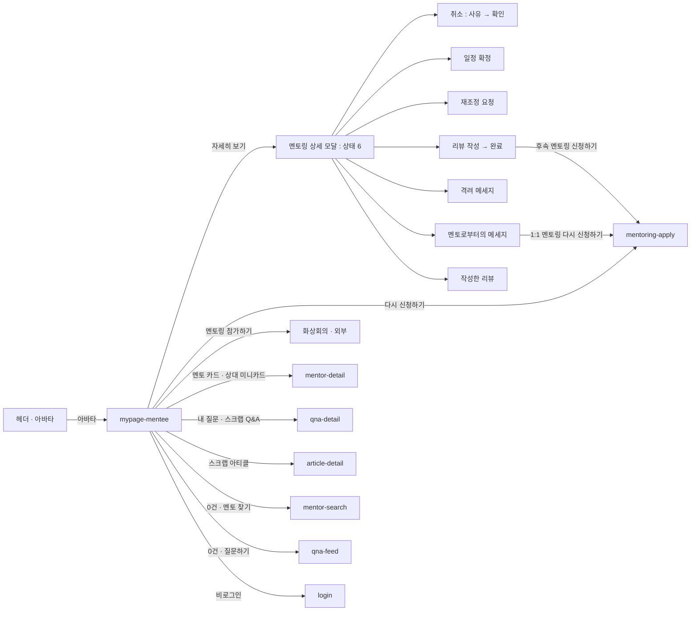

# mypage-mentee: 마이페이지(멘티)

- 상태: **기안** (§1~11 작성 2026-10-14 · 같은 날 새 와이어 `878:56842` 로 고침 · **UX승인 대기** — §11 의 결정 10건. 통화 · 탭 이동은 상혁이 정했다). **`template/` 1판 취임 2026-10-15** — 검수 1차 [UI-REVIEW](UI-REVIEW.md) · 고칠 것 15건은 Claude Design 2차
- 화면 구분: 허브
- 템플릿: 없음. Claude Design 에서 만든다 — 프롬프트 `design/_import/prompts/mypage-1014.md`. **멘토 마이페이지와 한 장**(`MyPage` · 주소의 `role` 로 바꿔 본다)
- **부품이 없는 자리** — 세로 내비(`DS-17`) · 멘토링 카드(`DS-18`) · 사람 미니카드(`DS-119`). 임시 조립을 그대로 쓰고 `data-temp` 를 붙인다
- **멘토 마이페이지는 이 문서를 틀로 쓰고 다른 것만 적는다** — [`../mypage-mentor/UI-SPEC.md`](../mypage-mentor/UI-SPEC.md)

> 출처: Figma `zFWjJinW6NAtyMMzMujNl2` / **`878:56842` 「마이페이지」(최신본 · 상혁 2026-10-14)** — 멘티 구역 `878:56843`(탭별 프레임 10) · 1.0 실서비스 캡처 5장(`878:56737`〜`56741` · 메일 · 시간대 · 비밀번호 · 탈퇴 · 최소금액). **편집 모달 11 ＋ 비밀번호 변경 3 은 옛 판 `1059:42622`(멘티 구역 `1059:42623`)에만 있어 거기서 읽는다.** 멘토링 상세 모달은 「멘토링 신청 / 확정 Flow」 `1059:31880`(멘티 `1059:31881` · 멘토 `1059:33275`). 메모 13장(`883:60448`〜`60478` · `963:29789` · `29795` · `29798` · `880:60444`). 읽은 날 2026-10-14. **카드 상태와 메세지 모달은 「멘토링 카드 일람」 멘티 `878:57647` 이 정본이다**(2026-10-15 대조 · 섹션에 「갱신 필요」 메모가 붙어 있다).

---

# 1부 — UX 설계 의도 (§1~5)

> **이 5절을 먼저 승인받는다.** 승인 전에 §6 이하로 내려가지 않는다.

## 1. 화면의 사명

**「내 멘토링이 지금 어디까지 왔고, 내가 남긴 것이 어디 있는가」를 한 곳에서 답한다.** 왼쪽 메뉴 하나로 7가지를 오간다 — 프로필 · 나의 Q&A · 나의 1:1 멘토링 · 관심있는 멘토 · 나의 스크랩 · 결제 이력 · 계정 설정.

**가장 자주 오는 이유는 1:1 멘토링의 진행 상황이다.** 신청 → 수락 → 일정 → 확정 → 완료 → 리뷰가 전부 여기서 움직인다. 나머지는 내가 모아 둔 것(스크랩 · 관심 멘토)과 내가 남긴 것(질문)이다.

## 2. 대상 사용자와 상황

- 대상 사용자: **로그인한 멘티.** 멘토도 자기 신청을 보러 오지만 그쪽은 [`mypage-mentor`](../mypage-mentor/UI-SPEC.md) 다
- 상황: ① 헤더 아바타를 눌러 들어온다(착지는 **프로필** 탭 · [transition-map](../../docs/transition-map.md) §1) ② 신청 완료 · 알림 · 메일에서 **나의 1:1 멘토링**으로 바로 온다 ③ 결제 뒤 이력을 확인하러 온다
- 이용 패턴: 정기 확인. 1:1 멘토링이 걸려 있는 동안은 상주

**역할로 화면이 갈린다.** 멘티와 멘토는 메뉴 항목 · 탭 안의 내용 · 멘토링 카드의 액션이 다르다. 그래서 2화면이지만, **셸(헤더 · 왼쪽 메뉴 · 본문 틀 · 상태 4종)은 하나**다.

## 3. 액션 방침

- 주 액션: **1:1 멘토링 1건을 열어 다음 단계로 옮긴다** — 일정 확정 · 참가 · 리뷰 작성 · 취소
- 부 액션: 프로필 고치기 · 질문 수정 · 삭제(미답변만) · 관심 멘토 · 스크랩 해제 · 계정 설정 바꾸기

**이 화면에서 하지 않는 것**:

| 하지 않는 것 | 이유 |
|---|---|
| **멘토링을 새로 신청하지 않는다** | 신청은 `mentoring-apply`(멘토 상세에서 시작)다. 완료 카드의 「후속 멘토링 신청하기」도 그리로 보낸다 |
| **질문을 새로 쓰지 않는다** | `qna-compose` 다. 여기서는 내 질문을 보고, 답변 전인 것만 고치거나 지운다 |
| **영수증을 발행하지 않는다** | 와이어 메모 「영수증 발행 기능은 처음엔 없는걸로」(`963:29789`). 탭 이름도 **「결제 이력」**이다(§11 4) |
| **탈퇴를 바로 처리하지 않는다** | 와이어 메모 「문의를 통해 가능하도록 · 전면에 표시하지는 않음」(`963:29795`) · 1.0 실서비스도 서포트 메일 안내다(`878:56741`). 모달이 서포트 센터로 안내한다. **휴면 계정 전환은 바로 처리한다**(새 판 · 확인 모달) |
| **역할을 여기서 바꾸지 않는다** | 멘토 등록은 별 흐름이다. 메뉴에 「멘토 되기」를 두지 않는다 |

## 4. 구성과 하이어라키

**왼쪽 세로 메뉴 ＋ 오른쪽 본문의 2단이다.** 메뉴는 7항목(로그아웃은 메뉴에 없다 · 계정 설정 안). 본문은 **「제목 · 설명 · 상태 요약」 머리 → (탭) → 목록 · 카드** 의 같은 틀을 탭마다 쓴다.

| 순 | 메뉴 | 본문이 답하는 것 |
|---|---|---|
| 1 | **프로필** | 멘토에게 내가 어떻게 보이나 — 기본 정보 · 자기소개 · 흥미있는 국가 · 직종 · 시간대 |
| 2 | 나의 Q&A 멘토링 | 내 질문이 답을 받았나 — 답변 완료 ／ 답변 대기 |
| 3 | **나의 1:1 멘토링** | 멘토링이 어디까지 왔나 — 진행중(신청 · 일정 조율 · 확정) ／ 완료(완료 · 취소) |
| 4 | 관심있는 멘토 | 내가 모아 둔 멘토 |
| 5 | 나의 스크랩 | 내가 모아 둔 Q&A ／ 아티클 |
| 6 | 결제 이력 | 무엇에 얼마를 냈나 — 연도별 |
| 7 | 계정 설정 | 메일 · 시간대 · 알림 · 비밀번호 · **휴면 / 탈퇴** · 맨 아래 **로그아웃** |

**로그아웃은 메뉴에 없다.** 새 판(`878:56842`)이 옛 판의 메뉴 맨 아래 「로그아웃」을 지웠다. 09-10 결정대로 **계정 설정 탭의 맨 아래에 위계를 한 단 낮춘 글자**로 둔다(§11 2).

**위에서 아래로 「나 → 내 멘토링 → 내가 모은 것 → 돈 → 계정」이다.** 자주 움직이는 것(1:1)이 위, 가끔 만지는 것(설정)이 아래다.

**링크는 전부 같은 탭이다**(상혁 2026-10-14). 옛 판 메모의 「새 창」(멘토 · 아티클 · 스크랩 카드)은 따르지 않는다. 밖으로 나가는 것(화상회의 · 문서)만 새 창이다.

### 1:1 멘토링 탭 — 상태가 흐름이다

| 탭 | 묶음(위에서 아래로) | 카드가 하는 말 |
|---|---|---|
| **진행중** | 신청한 멘토링 → 일정 조율중인 멘토링 → 확정된 멘토링 | 「멘토의 수락을 기다리는 중입니다」 · 「멘토가 수락했습니다. 일정을 확정해주세요」 ／ 「멘토가 새 일정을 제시했습니다」 · 「2026.07.16 15:00 에 진행됩니다」 |
| **완료** | 완료된 멘토링 → 취소된 멘토링 | 「완료되었습니다. 리뷰를 작성해주세요」 ／ 쓴 뒤 「완료되었습니다」 · 「나의 요청에 의해 ／ 멘토의 사정에 의해 ／ 예정대로 실행되지 않아서 취소되었습니다」 |

**묶음의 순서가 할 일의 순서다.** 지금 내가 움직여야 하는 것(일정 확정 · 참가 · 리뷰)이 가까이 온다. 와이어는 신청 → 조율 → 확정 순이고 그대로 둔다 — 확정은 날짜가 정해져 기다리면 되는 것이라 아래다.

### 멘토링 상세 모달 — 카드의 「자세히 보기」

**상태 6의 한 모달이다**(`MentoringDetailModal` · [transition-map](../../docs/transition-map.md) §2). 신청 내용 전부(멘토 · 신청일 · 유형 · 제목 · 요청 상세 · 시간 · 일정 조율 요청사항 · 꽃송이)가 늘 있고, **맨 위의 상태 문구와 맨 아래의 버튼만 상태로 갈린다.**

| 상태 | 위 문구 | 아래 버튼 |
|---|---|---|
| 신청중 | 멘토의 수락을 기다리는 중입니다 | 멘토링 취소하기 |
| 일정 조율중 — 멘토가 일정을 보냄 | 멘토가 멘토링을 수락했습니다. 일정을 확정해주세요 ／ 새 일정을 다시 냈으면 「멘토가 새 일정을 제시했습니다. 일정을 확정해주세요」 | **일정 확정하기** · 멘토링 취소하기 |
| 일정 조율중 — 내가 재조정을 요청함 | 멘토에게 일정 재조정을 요청했습니다 | 멘토링 취소하기 |
| 확정 | 멘토링이 확정되었습니다. 아래 시간에 진행됩니다 ＋ 일시 · 링크 · 캘린더 추가 · 링크 복사 | **멘토링 참가하기** · 멘토링 취소하기(글자) |
| 완료 | 멘토링이 완료되었습니다. 리뷰를 작성해주세요 ／ 쓴 뒤 「멘토링이 완료되었습니다」 | 멘토로부터의 격려 메세지 보기(있을 때) · **리뷰 작성하기**(안 썼을 때) ／ 쓴 뒤 작성한 리뷰 보기 · 후속 멘토링 신청하기 |
| 취소 | 나의 요청에 의해 ／ 멘토의 사정에 의해 ／ 예정대로 실행되지 않아서 취소되었습니다 | 멘토 메세지 보기(멘토가 보냈을 때) · **다시 신청하기** |

**모달을 겹치지 않는다.** 취소(사유 → 확인 2스텝) · 일정 확정 · 재조정 요청 · 리뷰 작성 · 작성한 리뷰 · 격려 메세지 · 멘토로부터의 메세지는 **같은 모달의 화면을 갈아끼운다**(`transition-map` §2 판정).

### 모바일(768 이하)

**왼쪽 메뉴가 위로 올라와 가로 스크롤 탭이 된다**(`Tabs size="s"`). 본문은 1단. 하단 탭바는 **「MY 멘트리」 활성.** 모달은 전체 화면(`Dialog mobile="fullscreen"`). 로그아웃은 계정 설정 탭 맨 아래 그대로.

## 5. 적용 패턴 (P-nn)

| 패턴 | 이 화면에서의 적용 |
|---|---|
| `P-01` 로그인의 벽을 액션마다 가른다 | **화면 전체가 로그인 뒤다.** URL 로 들어오면 로그인으로 보내고 로그인 뒤 그 탭으로 돌려보낸다 |
| `P-02` 0건의 면에서 다음 행동을 낸다 | 탭마다 0건의 말이 다르다 — 1:1 「아직 신청한 멘토링이 없어요」 ＋ **「멘토 찾기」** · Q&A 「아직 질문이 없어요」 ＋ **「질문하기」** · 스크랩 · 관심 멘토 「아직 모아 둔 것이 없어요」 ＋ 그 목록으로 · 결제 「결제 이력이 없어요」 버튼 없음 |
| `P-04` 목록의 상태를 URL 에 담는다 | **탭과 하위 탭을 URL 에 담는다**(`?tab=mentoring&sub=done`). 뒤로가기로 탭이 되돌아간다. 페이지 · 정렬도 담는다(스크랩 · 나의 Q&A) |
| `P-06` 쓰다 만 것을 잃지 않게 한다 | 편집 모달 전부 — 바꾼 것이 있을 때만 닫기 전에 한 번 묻는다 |
| `P-07` 제출은 조건을 채웠을 때만 켠다 | 편집 모달의 「저장하기」 · 리뷰의 「리뷰 작성하기」(필수 1칸) · 취소의 「확인」(사유 필수) |
| `P-08` 글자 수는 상자 밖에서 세고 잘라내지 않는다 | 소개글 500 · 리뷰 1000 · 취소 사유 · 격려 메세지 |
| `P-09` 되돌릴 수 있는 조작은 묻지 않고 실행취소를 준다 | **관심 멘토 해제 · 스크랩 해제** — 목록에서 바로 지우고 `Toast` 「실행취소」. 와이어 메모 「삭제 확인 모달」(`883:60472`)과 다르다 — §11 7 |
| `P-11` 맥락을 지키는 간략형과 전부 보는 전체형 | **적용하지 않는다.** 멘토링 상세는 모달뿐이고 전체 페이지가 없다(모달에 URL 을 붙이는 문제는 `transition-map` 미결 5) |

### 승격 후보 — 탭 머리의 「제목 · 설명 · 상태 요약」

**탭 7개가 같은 머리를 쓴다.** h0 제목 ＋ 한 줄 설명 ＋ 요약 칩(시간대 · 받은 꽃송이 · 답변 수). 멘토 마이페이지도 같다. 2화면째이니 UX승인 뒤 `UX-PATTERNS.md` 로 올린다(헌장 원칙 7).

컴포넌트 레벨의 규칙은 [DESIGN.md](../../DESIGN.md) 를 따르고 여기에 중복해서 쓰지 않는다.

---

# 2부 — 구조 (§6~11)

## 6. 블록별 규칙 (구성 요소 포함)

**요소명은 [용어집](../../../docs/glossary/ubiquitous-language.md) English 열이다.**

### 셸 — 멘티 · 멘토 공통

| 요소명(English) | 종류 | 내용 | 이 화면에서의 규칙 |
|---|---|---|---|
| `Header` · `Footer` · `BottomTabBar` | 부품 | 공통 내비 | 헤더 활성 메뉴 **없음.** 하단 탭바 활성 **「MY 멘트리」** |
| **세로 메뉴** | **임시 조립**(`DS-17`) | 7항목 | 폭 280 · 항목 높이 48 · 선택은 초록 면(`--green-100`) ＋ `--primary` 글자. 하위가 있는 항목은 ▼ 로 접힌다(멘토만). **로그아웃은 메뉴에 없다**(새 판) |
| 본문 | 조립 | 탭 머리 ＋ 내용 | 폭은 컨테이너에서 메뉴 280 ＋ 간격 32 를 뺀 나머지 |
| 탭 머리 | 조립(승격 후보) | h0 제목 · caption 설명 · 요약 칩 | 시간대 칩 「나의 시간대 (GMT+09:00) 한국 표준시」 ＋ `Tooltip` ? ＋ 「수정하기」 — 프로필 · Q&A · 1:1 탭 |
| 하위 탭 | `Tabs size="l" fill` | 2분할 | 나의 Q&A(답변 완료 ／ 답변 대기) · 1:1(진행중 ／ 완료) · 스크랩(Q&A ／ 아티클) |
| `Skeleton` · `EmptyState` · 에러 | 부품 · 조립 | 탭 본문의 4상태 | §7 |

### 1 프로필

| 블록 | 요소 | 규칙 |
|---|---|---|
| 시간대 줄 | 요약 칩 ＋ 「수정하기」 | 「시간대 설정」 모달 |
| 기본 정보 | `Card` · `Avatar` 96(연필) · 이름 h2 · `Flag` ＋ 「일본, 도쿄에서 활동중」 · 현재 상태 · 소속 | 「수정하기」 → **프로필 수정하기** 모달. 아바타 연필 → **프로필 사진 편집하기** |
| 자기소개 | `Card` · body | 「수정하기」 → 소개글 편집하기(`Textarea` 500) |
| 흥미있는 국가 | `Card` · `Chip` 여러 개 | 「수정하기」 → 흥미있는 국가(복수 선택 · `taxonomy.js` 의 국가) |
| 흥미있는 직종 | `Card` · `Chip` | 「수정하기」 → 흥미있는 직종(복수 선택 · 직무 12) |

**프로필 수정하기 모달은 한 장이고 「현재 상태」가 칸을 바꾼다**(와이어 3장 `1421:86988` · `87185` · `1433:87613`을 한 모달로).

| 현재 상태 | 더 뜨는 칸 |
|---|---|
| 재직 | 재직중인 회사 · 재직중인 직종(대분류 · 소분류 · 직종명) |
| 학생 | 학교명 · 전공 |
| 그 밖 | 커리어 소개(한 줄) |

공통 칸: 이름 · 현재 상태(`Select`) · 거주중인 국가(나라 `Select` · 도시 `Input`). 모달의 모양 · 저장 · 닫기 규칙은 `mentor-detail` 편집 면 「모달 공통」과 같다.

### 2 나의 Q&A 멘토링

| 블록 | 요소 | 규칙 |
|---|---|---|
| 머리 | 제목 · 「내가 질문한 Q&A 멘토링 리스트입니다. 멘토의 답변이 달린 이후에는 수정/삭제할 수 없습니다.」 · 시간대 칩 | |
| 하위 탭 | **답변 완료 (8) ／ 답변 대기 (3)** | 와이어 「답변완료」 · 「미답변」 |
| 목록 | `QnaListItem variant="question"` | `qna-feed` 의 행과 같은 부품. 누르면 `qna-detail`(질문자 면) |
| 답변 대기의 행 | ＋ 「수정」 · 「삭제」 글자 버튼 | 답변이 달리면 둘 다 사라진다. 삭제는 묻는다(`P-09` 아님 — 되돌릴 수 없다) |

### 3 나의 1:1 멘토링

| 블록 | 요소 | 규칙 |
|---|---|---|
| 머리 | 제목 · 「내가 신청한 1:1 멘토링 리스트입니다. 멘토가 멘토링을 수락한 이후 취소할 경우 취소 수수료가 부과됩니다.」 · **「취소 수수료에 대하여」** 링크 · 시간대 칩 | 링크의 목적지는 환불 규정 문서(§11 1 · 없다) |
| 하위 탭 | **진행중 (4) ／ 완료 (12)** | |
| 묶음 머리 | h3 「신청한 멘토링 (2)」 | 0건인 묶음은 세우지 않는다 |
| **멘토링 카드** | **임시 조립**(`DS-18`) | 아래 「멘토링 카드」 |

**멘토링 카드** — 6슬롯.

| 슬롯 | 무엇 | 규칙 |
|---|---|---|
| 배지 줄 | `Badge flag` 국가 · `Badge` 키워드 · **상태 배지** · 오른쪽 「자세히 보기 >」 | 상태 배지(이름은 카드 일람): 「신청중」 **주황**(`accent`) · 「일정 조율중」 초록 · 「멘토링 확정됨」 **파랑**(`tag hue="sky"`) · 「멘토링 완료」 뉴트럴 · 「취소됨」 뉴트럴 |
| 제목 | h3 「Q. 일본 디자이너 면접과 포트폴리오 리뷰 요청드립니다.」 | 1줄 말줄임 |
| 메타 | 「멘토링 신청일 : 2026.06.03」 · 「🌸 4송이 (8만원)」 ／ 확정이면 **「멘토링 예정일 : 2026.07.16 15:00」 초록** ／ 완료면 「멘토링 실시일 : 2026.07.16 15:00」 ／ 취소면 확정까지 갔을 때 예정일 · 아니면 신청일 | 송이 ＋ 원 병기(상혁 결정 ③). 일람은 취소 카드에도 「실시일」을 그렸다. 열리지 않은 멘토링이라 예정일 · 신청일로 썼다(2차 프롬프트 결정 6) |
| 요청 내용 | body muted · 3줄 말줄임 | |
| 상대 미니카드 | **`DS-119`** — `Avatar` 56 ＋ 이름 ＋ 소속 · 직함 ＋ > | 누르면 멘토 상세(같은 탭) |
| 상태 줄 | 왼쪽 초록 문구 ＋ 오른쪽 버튼 1~2 | 아래 「상태 줄」 |

**상태 줄** — 멘티. 카드 일람 `878:57647` 그대로다. 버튼의 강조는 일람의 초록을 따른다. 초록이 하나면 `primary`, 둘이면 할 일 쪽만 `primary` 이고 다른 쪽은 `outline tone="primary"`(DS-81)다. 흰 버튼은 `outline`, 회색은 `secondary` 비활성이다.

| 상태 | 문구 | 버튼 |
|---|---|---|
| 신청중 | 멘토의 수락을 기다리는 중입니다. | `outline` 멘토링 취소하기 |
| 일정 조율중(멘토가 보냄) | 멘토가 멘토링을 수락했습니다. 일정을 확정해주세요. | `outline` **일정 확정하기** · 멘토링 취소하기 |
| 일정 조율중(멘토가 새 일정을 다시 냄) | 멘토가 새 일정을 제시했습니다. 일정을 확정해주세요. | 같다 |
| 일정 조율중(내가 요청) | 멘토에게 일정 재조정을 요청했습니다. | `secondary` 일정 조정중(비활성) · 멘토링 취소하기 |
| 확정 | 멘토링이 확정되었습니다. 2026.07.16 15:00 에 멘토링이 진행됩니다. | `primary` **멘토링 참가하기** · 멘토링 취소하기 |
| 완료 · 리뷰 전 | 멘토링이 완료되었습니다. 리뷰를 작성해주세요. | 격려가 있으면 `outline tone="primary"` 격려 메세지 보기 · `primary` **리뷰 작성하기** |
| 완료 · 리뷰 뒤 | 멘토링이 완료되었습니다. | 격려가 있으면 `primary` 격려 메세지 보기 · `outline` **작성한 리뷰 보기** |
| 취소 | 나의 요청에 의해 ／ 멘토의 사정에 의해 ／ 멘토링이 예정대로 실행되지 않아서 취소되었습니다. | 멘토가 메세지를 보냈으면 `outline` 멘토 메세지 보기 · `primary` **다시 신청하기** |

**「리뷰 완료」 배지는 두지 않는다.** 검수 1차 ⑤ 는 이것으로 닫힌다. 「다시 신청하기」와 「1:1 멘토링 다시 신청하기」는 그 멘토의 `mentoring-apply` 로 간다(같은 탭).

**메세지 · 리뷰 모달** — 멘티. 상세 모달과 같은 틀(`Dialog` 640)이고 겹치지 않는다.

| 모달 | 여는 곳 | 안 | 바닥 |
|---|---|---|---|
| 격려 메세지 | 완료 카드 「격려 메세지 보기」 | 「멘토로부터 격려 메세지가 도착했습니다.」 · `--green-50` 원 ＋ 아이콘(일람의 Cheers 그림 자리) · 본문 | 리뷰 전 `primary` 리뷰 작성하기 · `outline` 닫기 ／ 리뷰 뒤 닫기 |
| 멘토로부터의 메세지 | 취소 카드 「멘토 메세지 보기」 | 「멘토로부터 메세지가 도착했습니다.」 · 원 ＋ 아이콘 · 본문 | `primary` **1:1 멘토링 다시 신청하기** · `outline` 닫기 |
| 리뷰 작성 → 작성 완료 | 「리뷰 작성하기」 | 1판 그대로 | |
| 작성한 리뷰 | 「작성한 리뷰 보기」 | 리뷰 작성 모달의 두 칸을 읽기 전용으로. **일람에 없다**(창조 · 2차 프롬프트 결정 7) | `outline` 닫기 |

### 4 관심있는 멘토

`MentorCard` 격자 3열(769 이상) · 「관심있는 멘토 (8)」 머리. 카드의 저장 토글을 끄면 **바로 빠지고 `Toast` 「실행취소」**(`P-09`). 카드 → 멘토 상세(같은 탭).

### 5 나의 스크랩

| 하위 탭 | 요소 | 규칙 |
|---|---|---|
| Q&A 멘토링 (42) | `QnaCard` 격자 3열 ＋ `Pagination` | 스크랩 토글을 끄면 바로 빠지고 `Toast` 「실행취소」 |
| 아티클 (42) | `ArticlePreview variant="row"` ＋ `Pagination` | 같다 |

### 6 결제 이력

| 블록 | 요소 | 규칙 |
|---|---|---|
| 머리 | 제목 · 「결제 이력을 확인할 수 있습니다.」 · 「abc123@gmail.com」 요약 칩 | 영수증 문구는 뺀다(§3) |
| 연도 묶음 | h3 「2026년 (3건)」 | 최신 연도가 위 |
| 이력 행 | 조립 — 일시 caption · **금액 h2** · 수단 caption · 오른쪽 **「상세 보기」** | 금액은 **원**(「40,000원」 ＝ 2송이 · 상혁 2026-10-14). 상세 보기 → 그 멘토링의 상세 모달 |

### 7 계정 설정

| 항목 | 지금 값 | 액션 |
|---|---|---|
| 연동된 메일 | `abc123@gmail.com` ＋ 「메일 매거진 수신중」 `Badge` | 「변경하기」 → **연동된 메일 설정** 모달(주소 · 메일 매거진 수신 `Switch`) |
| 시간대 변경 | `(GMT+09:00) 일본 표준시` | 「변경하기」 → **시간대 변경** 모달(지금 값 · 바꿀 시간대 `Select` · 1.0 실서비스 `878:56738` 와 같다) |
| 알림 설정 | — | 「알림 설정하기」 → **알림 설정** 모달(`Switch` 줄 — 1:1 멘토링 신청 · Q&A 답변 · …). `notification` 의 「알림 설정」이 여기로 온다. §11 5 |
| 비밀번호 변경 | — | 「비밀번호 변경하기」 → **비밀번호 변경** 모달(현재 · 새 · 확인 → 완료). 옛 판 · 1.0 은 별 페이지(`1059:45864`〜 · `878:56739`) — 모달로(§11 8) |
| **어카운트 휴면 / 커뮤니티 탈퇴** | 설명 「어카운트를 휴면계정으로 전환하거나 커뮤니티를 탈퇴할 수 있습니다.」 ＋ **「? 계정 정보 취급에 대하여」** 링크 | `outline` **「휴면 계정 전환하기」** → 확인 모달(휴면이면 무엇이 멈추나 · 되돌리는 법 ＝ 다시 로그인) ／ `outline` **「커뮤니티 탈퇴하기」** → 탈퇴 안내 모달(잃는 것 ＋ 서포트 센터 메일 복사 · 1.0 `878:56741`). 탈퇴는 바로 처리하지 않는다 |
| **로그아웃** | — | 탭 맨 아래 · 위계를 한 단 낮춘 글자 링크(09-10 결정 · §11 2) |

항목은 **「제목 h3 · 설명 caption · 값 상자(`Card`) ＋ 오른쪽 버튼」** 의 같은 행이다.

### 디자인 시스템에 없는 것

| 무엇 | 어떻게 세우나 | 기표 |
|---|---|---|
| 세로 메뉴 | `data-temp="DS-17"` — `insight-list` 의 카테고리 메뉴와 같은 조립 | `DS-17` 덧붙임 |
| 멘토링 카드 | `data-temp="DS-18"` — `Card` ＋ `Badge` ＋ `Button` 조립 | `DS-18` 덧붙임 |
| 사람 미니카드(상대 · 팔로워) | `data-temp="DS-119"` — `Avatar` ＋ 글자 2줄 ＋ > | **`DS-119` 신규** |
| 탭 머리 · 요약 칩 · 설정 행 · 이력 행 | 조립. 2화면째(멘토)라 승격 후보 | — |

## 7. 상태 목록

**탭마다 갖는다.** 셸(헤더 · 메뉴 · 탭 머리)은 늘 있다. 허브의 「블록마다 4상태」(`top` 승격 후보)와 같은 판단이다.

| 상태 | 표시 내용 | 비고 |
|---|---|---|
| 정상 | §6 그대로 | 1:1 진행중 탭은 묶음 3개가 다 있는 판 |
| 로딩 | 본문 자리에 `Skeleton` — 카드 3장 ／ 행 5줄 | 탭 머리는 그대로 |
| 빈 상태 | `EmptyState md` — 탭마다 문구 ＋ 다음 행동(§5 `P-02`) | 1:1 진행중 0건이면 「아직 진행중인 멘토링이 없어요」 ＋ 「멘토 찾기」 |
| 에러 | 본문 자리에 「불러오지 못했어요」 ＋ 「다시 시도」 | |

**`template/` 는 주소의 `state` 로 네 상태를 낸다.** 탭 7 × 상태 4 를 파일로 늘리지 않는다(2026-10-14 규칙).

**에러 시의 거동·대체 플로우**:

- **탭 본문을 못 불러왔다** → 그 본문만 에러. 메뉴와 머리는 살려 둔다. 다른 탭으로 옮길 수 있다
- **저장(편집 모달)이 실패했다** → 모달을 닫지 않는다. 버튼 아래 사유 한 줄 ＋ 버튼 되살림(`mentor-detail` 편집 면과 같다)
- **취소 · 일정 확정 · 리뷰 작성이 실패했다** → 같다. 모달 안에서 알리고 되살린다
- **관심 멘토 · 스크랩 해제가 실패했다** → 카드를 되돌리고 `Toast`
- **비로그인이 URL 로 들어왔다** → 로그인으로. 로그인 뒤 그 탭으로

## 8. 표시·활성 제어의 판정 조건과 아크션

| 판정 조건 | 아크션 |
|---|---|
| **비로그인이다** | 로그인으로 보낸다. 돌아올 자리는 그 탭 |
| **멘토 계정이다** | `mypage-mentor` 로 간다(`transition-map` §1) |
| 헤더 아바타로 들어왔다 | **프로필** 탭 |
| 신청 완료 · 알림 · 메일에서 들어왔다 | **나의 1:1 멘토링 · 진행중** 탭. 알림이 가리킨 카드가 있으면 그 카드로 스크롤 |
| 메뉴를 눌렀다 | 본문만 바뀐다. URL 의 `tab` 이 바뀐다(`P-04`) |
| 하위 탭을 눌렀다 | URL 의 `sub` 가 바뀐다 |
| 1:1 묶음이 0건이다 | 그 묶음을 세우지 않는다 |
| 1:1 전부가 0건이다 | 빈 상태 ＋ 「멘토 찾기」 |
| 카드의 「자세히 보기」를 눌렀다 | **멘토링 상세 모달**을 그 상태로 연다 |
| 모달 안에서 취소 · 확정 · 리뷰를 눌렀다 | **같은 모달의 화면을 갈아끼운다.** 겹치지 않는다 |
| 취소를 확인했다 | 카드가 **완료 탭의 취소 묶음**으로 옮겨 간다. `Toast` 「멘토링을 취소했어요」 |
| 일정을 확정했다 | 카드가 **확정 묶음**으로. 예정일이 초록으로 선다 |
| 리뷰를 썼다 | 카드 문구가 「멘토링이 완료되었습니다.」로, 버튼이 **「작성한 리뷰 보기」**로 바뀐다. 격려가 있으면 「격려 메세지 보기」가 남는다. 모달은 「후속 멘토링 신청하기」 ＋ 닫기 |
| 멘토의 격려 메세지가 있다 | 완료 카드에 「격려 메세지 보기」가 선다. 없으면 버튼이 없다(와이어 메모) |
| 멘토가 새 일정을 다시 냈다 | 일정 조율중 카드의 문구가 「멘토가 새 일정을 제시했습니다. 일정을 확정해주세요.」로 |
| 취소된 카드다 | 사유와 상관없이 **「다시 신청하기」**가 선다. 멘토가 메세지를 보냈으면 「멘토 메세지 보기」도 선다 |
| 「다시 신청하기」 · 「1:1 멘토링 다시 신청하기」를 눌렀다 | 그 멘토의 `mentoring-apply` 로 간다(같은 탭) |
| **답변 대기 질문**이다 | 행에 「수정」 · 「삭제」. 답변이 달리면 둘 다 사라진다 |
| 관심 멘토 · 스크랩 토글을 껐다 | **바로 빼고 `Toast` 「실행취소」**(`P-09`) |
| 편집 모달에서 바꾼 것이 있는데 닫는다 | 한 번 묻는다(`P-06`) |
| 「휴면 계정 전환하기」를 확인했다 | 로그아웃되고 `login` 으로. 다시 로그인하면 휴면이 풀린다(§11 9) |
| 「로그아웃」을 눌렀다 | 묻지 않고 로그아웃 · `top` 으로 |
| 편집 모달의 필수가 비었다 | 「저장하기」 비활성(`P-07`) |
| 프로필 수정의 「현재 상태」를 바꿨다 | 그 상태의 칸으로 바뀐다. 입력한 값은 상태 안에서만 남는다 |
| **768 이하**다 | 메뉴가 위 가로 탭 · 본문 1단 · 카드 폭 100% · 모달 전체 화면 · 하단 탭바 「MY 멘트리」 활성 |

## 9. 화면 전이

**전이도의 정본은 [transition-map.md](../../docs/transition-map.md) §1 · §2 · §4 다.**

- 들어오는 길: 헤더 아바타(프로필 탭) · 신청 완료 「나의 멘토링」 · 알림 「자세히 보기」 · 메일 링크
- **전부 같은 탭**(상혁 2026-10-14). 화상회의 · 문서만 새 창
- 「취소 수수료에 대하여」 · 「서포트 센터」 는 문서 · 메일이다(목적지 §11 1)

## 10. 의존 API

| API (용도) | 계약 |
|---|---|
| 내 프로필(읽기 · 수정 · 사진 · 소개글 · 흥미 국가 · 직종 · 시간대) | **계약 미정의** |
| 내 질문 목록(답변 완료 ／ 대기 · 정렬 · 페이지) · 질문 수정 · 삭제 | **계약 미정의** |
| 내 1:1 멘토링 목록(진행중 ／ 완료 · 묶음별) · 1건 상세 | **계약 미정의.** 상태 6 과 「상대가 보낸 메세지」를 함께 준다 |
| 멘토링 취소(사유) · 일정 확정 · 재조정 요청 · 리뷰 작성 · 격려 메세지 읽기 | **계약 미정의** |
| 관심 멘토 목록 · 해제 · 되돌리기 | **계약 미정의** |
| 스크랩 목록(Q&A ／ 아티클 · 페이지) · 해제 · 되돌리기 | **계약 미정의** |
| 결제 이력(연도별) | **계약 미정의.** 통화는 **원** |
| 계정 설정(메일 · 매거진 수신 · 시간대 · 알림 · 비밀번호) · 휴면 전환 · 탈퇴 안내 · 로그아웃 | **계약 미정의** |
| 취소 수수료 · 환불 규정 문서 | **문서가 없다**(§11 1) |

**미정의인 채로 구현 인계하지 않는다.**

## 11. 미결 사항

| # | 무엇 | 왜 못 정하나 · 2026-10-14 기본값 | 언제 걸리나 |
|---|---|---|---|
| 1 | **환불 규정 · 취소 수수료** | 문서가 없다([PRODUCT](../../../docs/PRODUCT.md) 미결 1). 「취소 수수료에 대하여」 링크와 취소 모달의 안내 문구가 비어 있다. **기본값: 링크는 `#` · 문구는 「멘토가 수락한 뒤의 취소에는 수수료가 붙습니다」 한 줄** | 사업 |
| 2 | **로그아웃 자리** | 옛 판은 메뉴 맨 아래, **새 판(`878:56842`)은 어디에도 없다.** 09-10 결정 「계정 설정 안 · 위계 낮춤」을 따른다. **기본값: 계정 설정 탭 맨 아래 글자 링크** | UX승인 |
| 4 | **영수증 발행** | 와이어 메모 「처음엔 없는걸로」(`963:29789`). 새 판도 메뉴 이름은 「결제 이력 / 영수증 발행」이다. **기본값: 탭 이름 「결제 이력」 · 영수증 버튼 없음** | UX승인 |
| 5 | **알림 설정의 항목** | 새 판은 「알림 설정하기」 버튼만 있고 항목이 없다(옛 판 모달 `1419:86696` 은 2항목 ＋ 「XXX」). **기본값: 1:1 멘토링 신청 · Q&A 답변 · 멘트리 소식 3줄** | UX승인 |
| 7 | **스크랩 · 관심 멘토 해제** | 와이어 메모는 「삭제 확인 모달」(`883:60472`). 리포 패턴 `P-09` 는 묻지 않고 실행취소. **기본값: `P-09`** | UX승인 |
| 8 | **비밀번호 변경의 형태** | 옛 판 · 1.0 은 별 페이지 3장(`878:56739`). 페이지 수를 늘리지 않는다. **기본값: 계정 설정 안의 모달** | UX승인 |
| 9 | **휴면 계정의 규칙** | 새 판이 버튼을 더했고(`878:56335`) 메모는 「재가입 장벽 ↓ · 메일 매거진 등 노이즈 ↓」(`883:60478`). 휴면 중 무엇이 멈추고 어떻게 풀리는지 정한 적이 없다. **기본값: 확인 모달 → 로그아웃 · 알림 · 메일 매거진 정지 · 프로필 비공개 · 다시 로그인하면 풀림** | 사업 · UX승인 |
| 10 | **모바일 메뉴** | 와이어가 데스크톱뿐이다. **기본값: 위 가로 스크롤 탭** | UX승인 |
| 11 | **모달에 URL 이 붙는가** | `transition-map` 미결 5. **기본값: 안 붙인다** | 알림 연동 |
| 12 | **「계정 정보 취급에 대하여」의 목적지** | 새 판의 링크. 문서가 없다. **기본값: `#`** | 사업 |

**2026-10-14 에 상혁이 정한 2건** — ③ **통화는 원**(1송이 ＝ 2만원 · 와이어 메모 `1509:25662` · 1.0 실서비스 최소금액 슬라이더 `878:56740`). 제품 전제(USD · $10)를 바꿨다 — [PRODUCT](../../../docs/PRODUCT.md) · 용어집 · `UX-PATTERNS` 참조원 전제. ⑥ **링크는 같은 탭** — 옛 판 메모의 「새 창」 3장을 따르지 않는다. 화상회의 · 문서만 새 창.

**새 판에서 결착된 것** — 「알림 설정」은 새 판에 메모 없이 남아 있다(옛 판 메모 「페이즈1 빼나?」 삭제) → **둔다.** 「로그아웃 자리」 · 「알림 켜는 자리」 두 말은 이 화면의 UX승인으로 [screen-inventory](../../docs/screen-inventory.md) 에서 지운다.

## 실행 계획

- [x] 와이어를 읽는다 — 멘티 구역 10 프레임 · 모달 11 · 멘토링 상세 모달(신청/확정 Flow) (2026-10-14)
- [x] §1~5 를 쓴다 (2026-10-14 · 새 와이어 `878:56842` 로 고침) — **UX승인 대기**(§11 10건)
- [x] §6~11 을 쓴다 (2026-10-14)
- [x] 부족한 부품을 `DS-update-list.md` 에 기표한다 — `DS-119` 사람 미니카드 · `DS-17` · `DS-18` 덧붙임
- [ ] 승격 후보 「탭 머리」를 `UX-PATTERNS.md` 로 올린다 — UX승인 뒤
- [x] `template/` 을 Claude Design 에서 만들어 취임한다 — 프롬프트 `design/_import/prompts/mypage-1014.md`(멘토와 한 장) (2026-10-15 · 1판 export 10-14 23:56 · SHA `d86d01a26a42`)
- [x] 6품질축 감사와 표시 확인을 `UI-REVIEW.md` 에 남긴다 (1차 2026-10-15 · 97장 렌더 · 고칠 것 15건은 2차 프롬프트 `mypage-r2-1015.md`)
- [ ] Claude Design 2차 export 를 취임하고 검수 2차(15건 결착 · 대비 측정)를 남긴다
