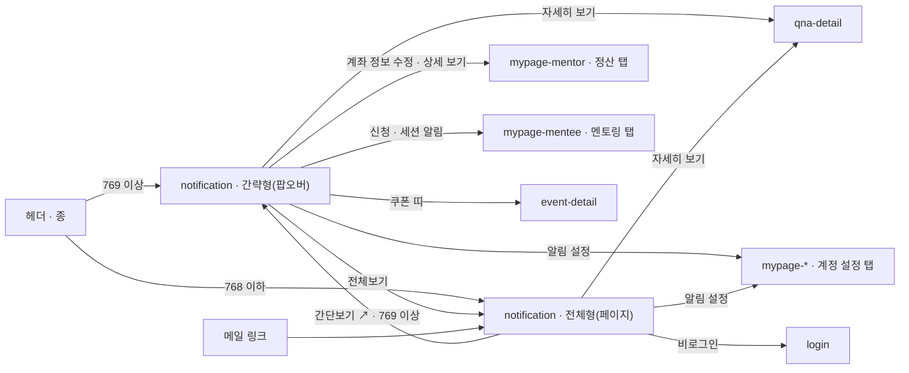

# notification: 알림

- 상태: **기안** (§1~11 작성 2026-10-14 · **UX승인 대기** — §11 의 결정 9건을 받으면 올린다)
- 화면 구분: 열람
- 템플릿: 없음. Claude Design 에서 만든다 — 프롬프트 `design/_import/prompts/notification-1014.md`
- **부품이 없는 자리** — 알림 카드(`DS-117`). 임시 조립을 그대로 쓰고 `data-temp="DS-117"` 를 붙인다

> 출처: Figma `zFWjJinW6NAtyMMzMujNl2` / `1059:40255` 「알림」 — PC 간략형 `1059:40256` · PC 전체형 `1059:40860` · 간략형 3상태 `1059:41331`(일반) · `1059:41479`(읽음) · `1059:41617`(없음) · **알림 패턴 보드** 캡처 9장(2026-08-17 · `1059:41015`〜`41019` · `41020` · `41164` · `41197` · `41636`). **사양 주석은 0건이다** — 규칙은 패턴 보드와 사람의 결정으로 채웠다. 간략형이 얹히는 TOP 은 「TOP + TONE & MANNER」(`1856:25912`)의 **오른쪽 판**(`1856:28444` 1440 · `1856:27510` 390)이 정본이다(상혁 2026-10-14). 읽은 날 2026-10-14.

---

# 1부 — UX 설계 의도 (§1~5)

> **이 5절을 먼저 승인받는다.** 승인 전에 §6 이하로 내려가지 않는다.

## 1. 화면의 사명

**「나에게 무슨 일이 생겼고, 지금 무엇을 해야 하는가」에 3초 안에 답한다.** 알림은 그 일이 있는 화면을 **가리키는 것**이다. 여기서 일을 끝내지 않는다.

**형태가 둘이다.** 헤더의 종 아래에 열리는 **간략형**(팝오버)과, 「전체보기」로 가는 **전체형**(페이지)이다. 같은 목록을 다른 깊이로 본다.

## 2. 대상 사용자와 상황

- 대상 사용자: **로그인한 멘티 · 멘토.** 비로그인에는 종이 없다(헤더 규칙 · [transition-map](../../docs/transition-map.md) §1)
- 상황: ① 종에 주황 점이 보여 누른다 ② 메일 알림의 링크로 전체형에 바로 들어온다 ③ 정산 · 결제처럼 돈이 걸린 일이 있어 확인하러 온다
- 이용 패턴: 정기 확인

**역할로 화면이 갈리지 않는다.** 멘티와 멘토는 **받는 알림의 종류**가 다를 뿐이고, 카드의 모양과 쌓이는 규칙은 같다.

## 3. 액션 방침

- 주 액션: **알림 하나를 눌러 그 일이 있는 화면으로 간다** — 「자세히 보기」 · 「상세 보기」 · 「계좌 정보 수정」
- 부 액션: 「모두 읽음」 · 「전체보기」(간략형 → 전체형) · 「간단보기」(전체형 → 간략형) · 「알림 설정」 · 「더보기」(전체형)

**이 화면에서 하지 않는 것**:

| 하지 않는 것 | 이유 |
|---|---|
| **알림 안에서 답하거나 결제하지 않는다** | 알림은 가리키는 것이다. 답변 · 결제 · 계좌 수정은 그 화면의 일이다 |
| **알림을 지우지 않는다** | 와이어에 삭제가 없다. 패턴 보드의 「스와이프 삭제」는 §11 2번 미결이다(2026-10-14 기본값 — 두지 않는다) |
| **검색 · 조건 · 탭을 두지 않는다** | 와이어에 없다. 쌓이는 순서가 이미 「해결 → 결정 → 인지」로 정해져 있어 고를 축이 없다 |
| **알림 설정을 여기서 바꾸지 않는다** | 「알림 설정」은 마이페이지 「계정 설정」 탭으로 보낸다. 켜고 끄는 자리는 그 화면이 갖는다([screen-inventory](../../docs/screen-inventory.md) 「알림 켜는 자리」) |
| **읽기 전에 읽음 처리하지 않는다** | 팝오버를 열기만 해서는 읽음이 되지 않는다. 카드나 그 액션을 눌러야 읽음이다. 「모두 읽음」만 예외다 |

## 4. 구성과 하이어라키

**위에서 아래로 「지금 해결할 것 → 내가 결정할 것 → 알아둘 것 → 공지」다.** 시간 역순은 같은 무리 안에서만 쓴다(패턴 보드 「패널 우선순위」).

### 간략형 — 헤더의 종 아래

| 순 | 블록 | 무엇을 하나 |
|---|---|---|
| 1 | 머리 | 종 아이콘 · 「알림 내역」 · **안 읽은 수**(초록 숫자) · 오른쪽 ✕ |
| 2 | 구분 줄 | 왼쪽 「새로운 알림」(초록) · 오른쪽 「모두 읽음」 글자 버튼 |
| 3 | **알림 카드** | 우선순위 순으로 쌓인다. 최근 **10건**까지. 그 안에서 스크롤 |
| 4 | **공지 · 프로모션 띠** | 점선 테두리 · 맨 아래 · ✕ 로 닫는다. 안 읽은 수에 **들어가지 않는다** |
| 5 | 바닥 | 가운데 「전체보기」 ｜ 「알림 설정」 |

**폭 520.** 헤더 바로 아래, 종에 오른쪽을 맞춘다. 높이는 내용을 따르되 **창 높이 − 헤더 − 24** 를 넘지 않는다. 넘치면 3 만 스크롤한다.

### 전체형 — 페이지

| 순 | 블록 | 무엇을 하나 |
|---|---|---|
| 1 | 되돌아가기 ← ＋ `Breadcrumb` 「알림 내역 상세」 · 오른쪽 끝 「간단보기 ↗」 | 「간단보기」는 헤더의 팝오버를 연다. 769 이상에만 있다 |
| 2 | 화면 제목 「알림 내역」 · 오른쪽 「모두 읽음」 | 간략형과 같은 동작 |
| 3 | **알림 카드** | 간략형과 같은 카드 · 같은 순서. 폭이 넓어 액션이 **오른쪽 끝 한 줄**에 선다 |
| 4 | **공지 · 프로모션 띠** | 간략형과 같다 |
| 5 | 「더보기」 | 가운데 primary. 다음 **10건**을 아래에 붙인다. 더 없으면 사라진다 |

### 카드의 세 단계 — 색은 「지금 손해 보는가」로 정한다

패턴 보드의 9패턴을 **카드 3단계**로 그린다. 단계는 색이고, 패턴은 안에 무엇을 채우는가다.

| 단계 | 모양 | 무엇이 오나 | 액션 |
|---|---|---|---|
| **L1** | 흰 카드 · 1px 테두리 | 기본 활동(답변 등록 · 도움돼요 · 신청 접수) · 묶음 · 일정 | 글자 링크 1 「자세히 보기 ↗」 |
| **L2** | 초록 틴트 면 | 거래 · 명세(꽃송이 지급 · 정산 완료) · 성취 · 보상 | `outline` 버튼 1 「상세 보기」 |
| **L3** | 빨강 틴트 면 ＋ 왼쪽 3px 바 | 실패 · 기한 경고(정산 보류 · 포인트 만료 임박) · 제재 | `outline` 버튼 1 — 해결 경로 하나 |

| 판정 조건 | 아크션 |
|---|---|
| 한 화면에 색 카드가 **3장 이상**이다 | **L2 1장 ＋ L3 1장까지만 색을 준다.** 나머지는 L1 로 그린다(패턴 보드 「조합 규칙 02」) |
| 같은 유형이 **3건 이상** 겹친다 | **1장으로 묶는다** — 아바타 묶음 ＋ 「외 N명의 멘티」 ＋ 펼치기(「조합 규칙 05」) |
| L3 를 읽었다 | **사라지지 않는다.** 해결될 때까지 맨 위에 남는다. 「모두 읽음」에서도 뺀다(「조합 규칙 04」) |
| L3 의 문제가 해결됐다 | **L2 성공 알림으로 바꾼다** — 「8월 정산이 완료되었습니다」(패턴 보드 P6 「해제」) |

### 모바일(768 이하)

**간략형이 없다.** 종을 누르면 전체형으로 간다. 폭 520 팝오버가 390 에 서지 않고, 와이어에도 모바일 간략형이 없다(§11 1번 · 2026-10-14 기본값).

전체형은 1단 그대로다. 카드 폭 100% · 액션은 카드 안 오른쪽 아래 · 「더보기」 폭 100%. 「간단보기」 링크가 없다. 하단 탭바는 활성 탭 없음.

## 5. 적용 패턴 (P-nn)

| 패턴 | 이 화면에서의 적용 |
|---|---|
| `P-01` 로그인의 벽을 액션마다 가른다 | **화면 전체가 로그인 뒤다.** 비로그인에는 종이 없고, 전체형 URL 로 들어오면 로그인으로 보낸다 |
| `P-02` 0건의 면에서 다음 행동을 낸다 | 0건이면 「새 알림이 없습니다」 ＋ 「질문에 답변이 달리거나 세션이 잡히면 여기에서 알려드립니다」. **버튼 없음** — 이 사람이 할 수 있는 것이 없다(`notice-list` 와 같은 판단) |
| `P-04` 목록의 상태를 URL 에 담는다 | **적용하지 않는다.** 조건 · 페이지가 없다. 「더보기」로 펼친 횟수는 URL 에 담지 않는다(`notice-list` 와 같다) |
| `P-05` 없는 글의 URL 은 404 로 받는다 | 알림이 가리키는 글이 내려갔으면 **그 화면의 404** 가 받는다. 알림 쪽에서 미리 거르지 않는다 |

### 승격 후보 — 간략형과 전체형을 둔다

**2화면째다.** `qna-detail` 이 「간단보기 패널 ＋ 전체 페이지」를 갖고(2026-10-13 유지로 정정), 이 화면이 「간략형 팝오버 ＋ 전체형 페이지」를 갖는다. 둘 다 **맥락을 떠나지 않고 보는 형태 하나 ＋ 전부 보는 형태 하나**이고, 서로 오가는 링크가 하나씩이다(「전체 페이지에서 보기」 ↔ 「간단보기」 · 「전체보기」 ↔ 「간단보기 ↗」).

| 판정 조건 | 아크션 |
|---|---|
| §1~5 가 UX승인을 받는다 | **`UX-PATTERNS.md` 로 올린다.** 번호는 그때 받는다(지금 가장 큰 번호가 `P-10`) |

컴포넌트 레벨의 규칙은 [DESIGN.md](../../DESIGN.md) 를 따르고 여기에 중복해서 쓰지 않는다.

---

# 2부 — 구조 (§6~11)

## 6. 블록별 규칙 (구성 요소 포함)

**요소명은 [용어집](../../../docs/glossary/ubiquitous-language.md) English 열이다.**

### 간략형

| 요소명(English) | 종류 | 내용 | 이 화면에서의 규칙 |
|---|---|---|---|
| `Header` | 부품 | 로그인 헤더 · 종에 주황 점 | `unread` ＝ 안 읽은 수 > 0(공지 · 프로모션 제외). **종을 누르면 화면이 팝오버를 연다** — 부품은 열지 않는다(`onNotify`) |
| `Popover` | 부품 | 껍데기 | `side="bottom"` · `align="end"` · `minWidth=520`. 반경 16 · 그림자. 종의 오른쪽에 맞춘다 |
| 머리 | 조립 | `Icon notification-01` ＋ 「알림 내역」(h3) ＋ 안 읽은 수(h3 · `--primary`) ＋ `IconButton ghost` ✕ | 안 읽은 수가 0 이면 숫자를 세우지 않는다 |
| 구분 줄 | 조립 | 「새로운 알림」(caption · `--primary`) ＋ 「모두 읽음」(`Button ghost sm`) | 0건이면 이 줄이 없다. 안 읽은 것이 없으면 「모두 읽음」을 비활성 |
| **알림 카드** ×≤10 | **임시 조립**(`DS-117`) | 아래 「알림 카드의 구성」 | 세로 간격 12. 안쪽 여백 16 |
| **공지 · 프로모션 띠** | **임시 조립**(`DS-117` 의 `promo` 변형) | 아이콘 상자 48 ＋ 라벨 「이벤트 · 08.20까지」(caption muted) ＋ 제목(body 600) ＋ 오른쪽 ✕ | 점선 1px `--border` · 반경 12. 띠 전체가 링크. **1장만** 세운다 |
| 바닥 | 조립 | `Button ghost tone="primary"` 「전체보기」 ＋ 세로선 ＋ 「알림 설정」 | 가운데 정렬. 위에 1px 선 |
| `EmptyState size="sm"` | 부품 | 0건 | `icon="package-open"` · 제목 · 설명. 액션 없음 |
| `Skeleton` | 부품 | 로딩 | 카드 자리 3장(높이 88) |

### 전체형

| 요소명(English) | 종류 | 내용 | 이 화면에서의 규칙 |
|---|---|---|---|
| `Header` · `Footer` · `BottomTabBar` | 부품 | 공통 내비 | 활성 메뉴 **없음.** 알림은 헤더 메뉴가 아니다 |
| `IconButton outline` ← ＋ `Breadcrumb` | 부품 | 「알림 내역 상세」 | ← 는 `history.back`. 들어온 곳이 없으면 `top` |
| 「간단보기 ↗」 | 조립 | `Button ghost sm` ＋ `Icon arrow-up-right-01` | 오른쪽 끝. **헤더의 팝오버를 연다.** 768 이하에는 없다 |
| 화면 제목 | 조립 | 「알림 내역」(h0) ＋ 오른쪽 「모두 읽음」(`Button ghost sm`) | 간략형과 같은 동작 · 같은 비활성 규칙 |
| **알림 카드** ×N | **임시 조립**(`DS-117`) | 간략형과 같은 카드 | 폭이 넓으면 액션이 **오른쪽 끝 세로 가운데**로 간다(와이어 `1059:40860`). 768 이하는 간략형과 같은 배치 |
| **공지 · 프로모션 띠** | 임시 조립 | 간략형과 같다 | |
| `Button primary md` 「더보기」 | 부품 | 가운데 | 한 번에 **10건.** 더 없으면 세우지 않는다. 부르는 동안 비활성 ＋ 아래에 `Skeleton` 3장 |
| `EmptyState size="md"` | 부품 | 0건 | 간략형과 같은 문구. 액션 없음 |

### 알림 카드의 구성 — 6슬롯

**9패턴이 같은 슬롯을 쓰고 무엇을 채우고 비우는지만 다르다**(패턴 보드 「공통 골격 · 6개 슬롯」).

| 슬롯 | 무엇 | 규칙 |
|---|---|---|
| 1 상태 점 | 지름 8 · `--primary` | **안 읽음에만.** 읽으면 사라진다 |
| 2 아이콘 · 아바타 | 사람이 주체면 `Avatar sm`, 시스템이면 `Icon` | L2 는 돼지저금통 · L3 는 `alert-circle`(`--destructive`) · 공지는 로켓. L1 기본 활동은 **비운다** |
| 3 유형 라벨 | `Badge sm` | **분류가 헷갈릴 때만**(결제 · 정산 · 제재). 기본 활동에는 없다 |
| 4 본문 | body · 600 | **2줄 고정 ＋ 말줄임.** 인용은 따옴표 「“…”」. 읽으면 `--muted-foreground` · 400 |
| 5 메타 | caption muted | 시각(「12분 전」 · 「2026.08.25」) · 기한(「08.25까지 미수정 시 다음 회차로 이월」 · L3 는 `--destructive`) · 묶음(「외 9명의 멘티」 · `--primary`) |
| 6 액션 | 링크 1 → 버튼 1 → 버튼 2 순으로 승격 | L1 `Button ghost tone="primary" sm` 「자세히 보기」 ＋ `arrow-up-right-01` ／ L2 · L3 `Button outline sm` 1개 |

**카드 전체는 링크가 아니다.** 누르는 곳은 슬롯 6 뿐이다. 본문을 눌러도 아무 일이 없다 — 슬롯 6 이 「읽음」의 유일한 길이라 사고로 읽음이 되는 것을 막는다.

### 9패턴 — 이 화면이 받는 알림의 종류

| 패턴 | 단계 | 무엇 | 실물이 와이어에 있나 |
|---|---|---|---|
| P1 기본 활동형 | L1 | 답변 등록 · 스크랩한 질문에 새 답변 · 신청 접수 · 수락 · 거절 · 채팅 · 관심 멘토의 새 답변 · 후기 답글 ／ 멘토: 매칭 질문 · 도움돼요 · 다른 멘토 답변 · 일정 선택 · 세션 확정 · 후기 등록(**15종**) | 있다(`1059:41020`) |
| P2 묶음형 | L1 | 같은 유형 3건 이상을 1장으로. 아바타 묶음 ＋ 펼치기 | 와이어 실물 1장(「12명이 도움돼요」) |
| P3 일정 · 리마인더형 | L1 | 세션 D-n · 10분 전 임박(primary 솔리드 「입장하기」) | **없다** |
| P4 응답 요청형 | L1 · 상단 고정 | 멘토링 신청 수락 · 거절(primary ＋ outline 2버튼) | **없다** |
| P5 거래 · 명세형 | L2 | 결제 · 영수증 · 환불 · 쿠폰 지급 ／ 멘토: 정산 완료 · 세금계산서(**6종**) | 있다(`1059:41164`) |
| P6 실패 · 기한 경고형 | L3 | 결제 실패 · 결제수단 만료 · 포인트 만료 ／ 멘토: 응답 지연 · 정산 실패 · 정산 수단 미등록(**6종**) | 있다(`1059:41197`) |
| P7 필수 고지 · 제재형 | 중립 · L3 | 사유 인용 블록 ＋ 「필수」 배지 · 이의신청 | **없다** |
| P8 성취 · 보상형 | L2 | 지표 숫자 ＋ 공유 | **없다** |
| P9 공지 · 프로모션형 | 띠 | 점선 띠 · 하단 · ✕. 안 읽은 수에 안 들어간다 | 있다(쿠폰 띠) |

**실물이 없는 4패턴(P3 · P4 · P7 · P8)은 template 에서 세우지 않는다.** 패턴 보드의 종류 목록 캡처가 섹션에 없다(§11 3번). 받으면 §6 에 더한다.

### 임시 조립을 표시한다

알림 카드와 공지 띠에 `data-temp="DS-117"`. 부품이 오면 그 자리만 바꾼다.

## 7. 상태 목록

### 간략형

| 상태 | 표시 내용 | 비고 |
|---|---|---|
| 정상 | §6 그대로. 안 읽은 수 ＋ 카드 ＋ 공지 띠 | 와이어 「일반」 |
| **읽음** | 안 읽은 수 없음. 카드는 점 없이 muted 글자. 틴트는 유지 | 와이어 「읽음」. 「모두 읽음」 비활성 |
| 로딩 | 카드 자리에 `Skeleton` 3장 | 머리 · 바닥은 그대로 |
| 빈 상태 | `EmptyState sm` 「새 알림이 없습니다」 | 와이어 「없음」. 구분 줄 없음 · 바닥은 그대로 |
| 에러 | 카드 자리에 사유 ＋ `Button outline sm` 「다시 시도」 | **아래 「에러 시의 거동」 필수 기재** |

### 전체형

| 상태 | 표시 내용 | 비고 |
|---|---|---|
| 정상 | §6 그대로 | 읽음 · 안 읽음이 섞인 판 |
| 로딩 | 카드 자리에 `Skeleton` 5장 | 제목 줄은 그대로 |
| 빈 상태 | `EmptyState md` 같은 문구 | 「더보기」 없음 |
| 에러 | 카드 자리에 사유 ＋ 「다시 시도」 | |
| **더보기 끝** | 「더보기」가 없다 | 마지막 묶음까지 불렀다 |

**에러 시의 거동·대체 플로우**:

- **목록을 못 불러왔다** → 카드 자리에만 에러와 재시도. 머리 · 바닥(간략형) · 제목(전체형)은 살려 둔다
- **「모두 읽음」이 실패했다** → 점을 되돌리고 `Toast` 로 알린다
- **「더보기」가 실패했다** → 이미 있는 카드는 그대로. 버튼을 되살리고 `Toast` 로 알린다
- **알림이 가리키는 글이 내려갔다** → 그 화면의 404 가 받는다(`P-05`). 알림은 읽음 처리된다
- **비로그인이 전체형 URL 로 들어왔다** → 로그인으로 보내고, 로그인 뒤 전체형으로 돌려보낸다
- **문구는 미정이다**(§11 8번)

## 8. 표시·활성 제어의 판정 조건과 아크션

| 판정 조건 | 아크션 |
|---|---|
| **비로그인이다** | 종이 없다. 전체형 URL 은 로그인으로 보낸다 |
| 안 읽은 수가 **1 이상**이다(공지 · 프로모션 제외) | 종에 주황 점(`Header unread`). 간략형 머리에 숫자 |
| 안 읽은 수가 **0** 이다 | 점 없음 · 숫자 없음 · 「모두 읽음」 비활성 |
| **769 이상**에서 종을 눌렀다 | 간략형을 연다. 다시 누르면 닫는다 |
| **768 이하**에서 종을 눌렀다 | **전체형으로 간다.** 팝오버를 열지 않는다 |
| 간략형이 열려 있다 | ✕ · Esc · 바깥 클릭 · 종 재클릭으로 닫는다. 닫히면 포커스가 종으로 돌아간다(`Popover triggerRef`) |
| 간략형을 열었다 | **읽음 처리하지 않는다.** 점과 숫자가 그대로다 |
| 카드의 액션(링크 · 버튼)을 눌렀다 | 그 카드를 **읽음**으로 바꾸고 목적지로 간다. 간략형은 닫는다 |
| 「모두 읽음」을 눌렀다 | L1 · L2 전부를 읽음으로. **L3 와 P7 은 뺀다.** 숫자와 점이 사라진다. 묻지 않는다 |
| L3 카드가 있다 | **맨 위에 고정.** 읽어도 자리가 같다. 해결되면 L2 성공 알림으로 바뀐다 |
| 같은 유형이 3건 이상이다 | 1장으로 묶는다. 「펼치기」를 누르면 그 자리에서 아래로 펼친다 |
| 색 카드가 3장 이상이다 | L2 1장 ＋ L3 1장만 색. 나머지는 L1 |
| 공지 · 프로모션 띠의 ✕ 를 눌렀다 | 그 띠를 닫고 **다시 세우지 않는다**(같은 공지). 읽음과 무관하다 |
| 간략형의 카드가 10건을 넘는다 | 10건까지만. 11건째부터는 「전체보기」 |
| 전체형의 「더보기」를 눌렀다 | 다음 10건을 아래에 붙인다. 부르는 동안 버튼 비활성 ＋ `Skeleton` 3장 |
| 마지막 묶음까지 불렀다 | 「더보기」를 세우지 않는다 |
| 전체형의 「간단보기 ↗」를 눌렀다 | 헤더의 간략형을 연다. 페이지는 그대로 |
| 「알림 설정」을 눌렀다 | 마이페이지 「계정 설정」 탭으로 간다. 멘토는 `mypage-mentor`, 멘티는 `mypage-mentee` |
| **768 이하**다 | 「간단보기」 링크 없음 · 카드 액션은 카드 안 오른쪽 아래 · 「더보기」 폭 100% · 하단 탭바 활성 없음 |

## 9. 화면 전이

**전이도의 정본은 [transition-map.md](../../docs/transition-map.md) 다.** 여기에는 이 화면이 드나드는 것만 적는다.

- 종 → 간략형(769 이상) ／ 종 → 전체형(768 이하)
- 간략형 ↔ 전체형: 「전체보기」 ／ 「간단보기 ↗」
- 카드 → 그 일이 있는 화면: Q&A 답변 · 도움돼요는 `qna-detail`, 정산 · 꽃송이는 `mypage-mentor` 정산 탭, 신청 · 세션은 `mypage-mentee` 멘토링 탭
- 「자세히 보기」의 창: **전이도(2026-09-10)는 「새 창」이다.** 와이어 아이콘이 ↗ 라서다. §11 4번에서 다시 묻는다
- 「알림 설정」 → 마이페이지 「계정 설정」 탭. 실물은 아직 없다(`mypage-*` 「착수 전 준비」)
- **들어오는 길**: 헤더의 종 · 메일 알림의 링크(전체형 직행)

## 10. 의존 API

| API (용도) | 계약 |
|---|---|
| 알림 목록(우선순위 순 · 10건 단위 · 다음 묶음) | **계약 미정의.** 쌓이는 순서(해결 → 결정 → 인지 · 같은 무리 안 시간 역순)는 **서버가 정렬해서 준다.** 화면이 다시 정렬하지 않는다 |
| 안 읽은 수(공지 · 프로모션 제외) | **계약 미정의.** 헤더가 늘 부른다 |
| 읽음 처리 — 1건 · 전부(L3 · P7 제외) | **계약 미정의** |
| 묶음 펼치기(같은 유형 3건 이상의 원본 목록) | **계약 미정의** |
| 공지 · 프로모션 닫기(같은 공지를 다시 세우지 않는다) | **계약 미정의** |
| 알림 종류 64종의 목적지 URL | **계약 미정의.** 종류마다 어느 화면 · 어느 탭으로 가는지 — 패턴 보드 원본과 함께 받는다(§11 3번) |

**미정의인 채로 구현 인계하지 않는다.**

## 11. 미결 사항

| # | 무엇 | 왜 못 정하나 · 2026-10-14 기본값 | 언제 걸리나 |
|---|---|---|---|
| 1 | **768 이하의 형태** | 와이어에 모바일 간략형이 없다. **기본값: 종이 전체형으로 바로 간다.** 대안은 `Sheet`(아래에서 올라오는 패널) | UX승인 |
| 2 | **스와이프 삭제 · 개별 삭제** | 패턴 보드 「조합 규칙 04」가 스와이프 삭제를 전제하는데 와이어에 삭제가 없다. **기본값: 두지 않는다** | UX승인 |
| 3 | **알림 종류 64종의 원본** | 패턴 보드의 종류 목록 캡처가 P1 · P5 · P6 세 장뿐이다. P2 · P3 · P4 · P7 · P8 · P9 의 종류와 문구가 섹션에 없다. **디자이너에게 보드 원본을 받는다** | §6 보강 · API 합의 |
| 4 | **「자세히 보기」가 새 창인가 같은 탭인가** | 전이도(2026-09-10)는 ↗ 아이콘을 읽어 「새 창」으로 적었다. 같은 서비스 안의 Q&A 상세라 **같은 탭을 추천한다** — 아이콘은 「나간다」가 아니라 「간다」의 뜻으로 남긴다 | UX승인 · 전이도 개정 |
| 5 | **전체형의 「모두 읽음」** | 와이어 전체형에는 없다. 같은 목록이라 **기본값: 둔다**(제목 오른쪽) | UX승인 |
| 6 | **간략형의 건수 10** | 와이어는 6장을 그렸을 뿐이다. **10으로 둔다** | 구현 인계 전 |
| 7 | **L3 의 버튼 모양** | 패턴 보드 스펙은 「destructive 버튼 1」, 실물 캡처와 와이어는 흰 `outline`. **실물대로 `outline`** — 빨강 면 위에 빨강 버튼이면 글자가 안 읽힌다 | UX승인 |
| 8 | **문구** | 빈 상태 · 에러 · 64종의 본문. UX 라이팅이며 한/일 2개국어 | UX 라이팅 착수 |
| 9 | **`DS-117` 번호** | DS 번호가 미결이다([DS-update-list](../../DS-update-list.md) 「다음 새 항목」). **`DS-117` 을 임시로 받았다** — 디자이너 번호를 옮기는 안이 채택되면 이 번호만 바꾼다 | 상혁 결정 |

**이 화면이 다른 화면에 남기는 것** — `mypage-*` 「알림 켜는 자리」(계정 설정 탭)가 이 화면의 「알림 설정」 목적지다. 그 화면이 착수되면 §9 의 `setj` 를 실물로 바꾼다.

## 실행 계획

- [x] 와이어와 패턴 보드를 읽는다 (2026-10-14)
- [x] §1~5 를 쓴다 (2026-10-14) — **UX승인 대기**(§11 1 · 2 · 4 · 5 · 7)
- [x] §6~11 을 쓴다 (2026-10-14)
- [x] 부족한 부품을 `DS-update-list.md` 에 기표한다 — `DS-117` 알림 카드
- [ ] 승격 후보 「간략형과 전체형을 둔다」를 `UX-PATTERNS.md` 로 올린다 — UX승인 뒤
- [ ] `template/` 을 Claude Design 에서 만들어 취임한다 — 프롬프트 `design/_import/prompts/notification-1014.md`(TOP 은 뼈대만)
- [ ] 6품질축 감사와 표시 확인을 `UI-REVIEW.md` 에 남긴다
