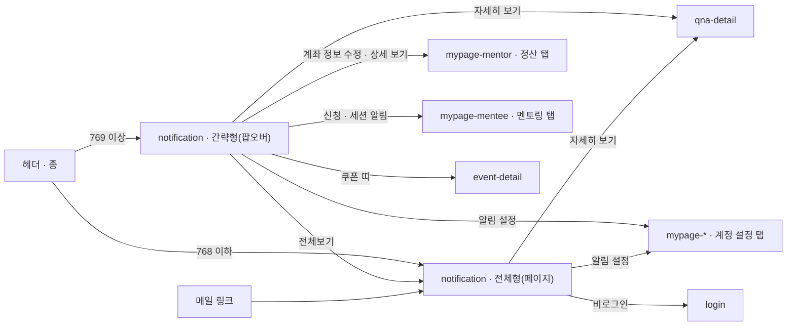

# notification: 알림

- 상태: **확정** (§1~5 UX승인 2026-10-14 — 결정 9건 · §6~11 작성 2026-10-14 · `template/` 취임 2026-10-14 — **2판 export**(상혁이 Claude Design 에서 고친 판 · 18:15))
- 화면 구분: 열람
- 템플릿: [`template/Notification.dc.html`](template/Notification.dc.html) — 주소로 형태 · 역할 · 상태를 고른다. 출처는 [`template/SOURCE.md`](template/SOURCE.md). 간략형의 바탕은 **진짜 TOP** — 알림 프로젝트 안에 다시 그린 `TopBackdrop`
- **값의 정본은 Claude Design 이다.** 2판(2026-10-14 18:15)은 상혁이 거기서 직접 고쳤다. 이 문서의 수치는 그 판을 따른다 — 와이어 수치로 되돌리지 않는다
- **부품이 없는 자리** — 알림 카드(`DS-117`). 임시 조립을 그대로 쓰고 `data-temp="DS-117"` 를 붙인다

> 출처: Figma `zFWjJinW6NAtyMMzMujNl2` / `1059:40255` 「알림」 — PC 간략형 `1059:40256` · PC 전체형 `1059:40860` · 간략형 3상태 `1059:41331`(일반) · `1059:41479`(읽음) · `1059:41617`(없음) · **알림 패턴 보드** 캡처 9장(2026-08-17 · `1059:41015`〜`41019` · `41020` · `41164` · `41197` · `41636`). **사양 주석은 0건이다** — 규칙은 패턴 보드와 사람의 결정(상혁 2026-10-14 · 9건)으로 채웠다. 간략형이 얹히는 TOP 은 「TOP + TONE & MANNER」(`1856:25912`)의 **오른쪽 판**(`1856:28444` 1440 · `1856:27510` 390)이 정본이다(상혁 2026-10-14). 읽은 날 2026-10-14.

---

# 1부 — UX 설계 의도 (§1~5)

## 1. 화면의 사명

**「나에게 무슨 일이 생겼고, 지금 무엇을 해야 하는가」에 3초 안에 답한다.** 알림은 그 일이 있는 화면을 **가리키는 것**이다. 여기서 일을 끝내지 않는다.

**형태가 둘이다.** 헤더의 종 아래에 열리는 **간략형**(팝오버)과, 「전체보기」로 가는 **전체형**(페이지)이다. 같은 목록을 다른 깊이로 본다(`P-11`).

## 2. 대상 사용자와 상황

- 대상 사용자: **로그인한 멘티 · 멘토.** 비로그인에는 종이 없다(헤더 규칙 · [transition-map](../../docs/transition-map.md) §1)
- 상황: ① 종에 주황 점이 보여 누른다 ② 메일 알림의 링크로 전체형에 바로 들어온다 ③ 정산 · 결제처럼 돈이 걸린 일이 있어 확인하러 온다
- 이용 패턴: 정기 확인

**역할로 화면이 갈리지 않는다.** 멘티와 멘토는 **받는 알림의 종류**가 다를 뿐이고, 카드의 모양과 쌓이는 규칙은 같다.

## 3. 액션 방침

- 주 액션: **알림 하나를 눌러 그 일이 있는 화면으로 간다** — 「자세히 보기」 · 「상세 보기」 · 「계좌 정보 수정」
- 부 액션: 「모두 읽음」 · 알림 1건 삭제 · 「전체보기」(간략형 → 전체형) · 「간단보기」(전체형 → 간략형) · 「알림 설정」 · 「더보기」(전체형)

**이 화면에서 하지 않는 것**:

| 하지 않는 것 | 이유 |
|---|---|
| **알림 안에서 답하거나 결제하지 않는다** | 알림은 가리키는 것이다. 답변 · 결제 · 계좌 수정은 그 화면의 일이다 |
| **검색 · 조건 · 탭을 두지 않는다** | 와이어에 없다. 쌓이는 순서가 이미 「해결 → 결정 → 인지」로 정해져 있어 고를 축이 없다 |
| **알림 설정을 여기서 바꾸지 않는다** | 「알림 설정」은 마이페이지 「계정 설정」 탭으로 보낸다. 켜고 끄는 자리는 그 화면이 갖는다([screen-inventory](../../docs/screen-inventory.md) 「알림 켜는 자리」) |
| **읽기 전에 읽음 처리하지 않는다** | 팝오버를 열기만 해서는 읽음이 되지 않는다. 카드의 액션을 눌러야 읽음이다. 「모두 읽음」만 예외다 |
| **빨강 카드를 지우거나 모두 읽음으로 넘기지 않는다** | 해결 전까지 남는다. 지우면 손해 보는 일을 놓친다(패턴 보드 「조합 규칙 04」) |

## 4. 구성과 하이어라키

**위에서 아래로 「지금 해결할 것 → 내가 결정할 것 → 알아둘 것 → 공지」다.** 시간 역순은 같은 무리 안에서만 쓴다(패턴 보드 「패널 우선순위」).

### 간략형 — 헤더의 종 아래

| 순 | 블록 | 무엇을 하나 |
|---|---|---|
| 1 | 머리 | 종 아이콘 · 「알림 내역」(h3) · **안 읽은 수**(초록 · micro) · 오른쪽 ✕(sm) |
| 2 | 구분 줄 | 왼쪽 **「새로운 알림」 토글** — 누르면 안 읽은 것만 보인다(2판 · 밑줄로 켜짐 표시) · 오른쪽 「모두 읽음」 글자 버튼 |
| 3 | **알림 카드** | 우선순위 순으로 쌓인다. **최근 5건**까지. 넘치면 「전체보기」. **축소판**(반경 12 · 안쪽 12 · 본문 14 · 점 6) |
| 4 | **공지 · 프로모션 띠** | 점선 테두리 · 맨 아래 · ✕ 로 닫는다. 안 읽은 수에 **들어가지 않는다** |
| 5 | 바닥 | 가운데 「전체보기」 ｜ 「알림 설정」 — caption 600 · 높이 48 |

**폭 416 · 모서리 32.** 헤더 아래 선에서 6px 아래, **오른쪽 끝은 창 끝에서 2px**(와이어 `1059:40256` 그대로 · 2판). **높이는 창 높이의 70% 와 「창 아래 끝 − 헤더 − 16」 중 작은 쪽**을 넘지 않는다. 넘치면 머리와 바닥은 두고 3 · 4 만 스크롤한다.

### 전체형 — 페이지

| 순 | 블록 | 무엇을 하나 |
|---|---|---|
| 1 | 되돌아가기 ←(원형 32) ＋ `Breadcrumb` 「알림 내역 상세」 | **「간단보기」 링크는 없다**(2판에서 뺐다). 간략형으로 돌아가는 길은 헤더의 종이다 |
| 2 | 화면 제목 「알림 내역」(h2) · 오른쪽 「모두 읽음」 | 간략형과 같은 동작 |
| 3 | **알림 카드** | 간략형과 같은 카드 · 같은 순서. **본문 폭 768** 에 세운다. 액션이 **오른쪽 끝 세로 가운데**에 선다 |
| 4 | **공지 · 프로모션 띠** | 간략형과 같다 |
| 5 | 「더보기」 | 가운데 primary. 다음 **10건**을 아래에 붙인다. 더 없으면 사라진다 |

### 카드의 세 단계 — 색은 「지금 손해 보는가」로 정한다

패턴 보드의 9패턴을 **카드 3단계**로 그린다. 단계는 색이고, 패턴은 안에 무엇을 채우는가다.

| 단계 | 모양 | 무엇이 오나 | 액션 |
|---|---|---|---|
| **L1** | 흰 카드 · 1px 테두리 | 기본 활동(답변 등록 · 도움돼요 · 신청 접수) · 묶음 | 글자 링크 1 「자세히 보기 ↗」 |
| **L2** | 초록 틴트 면(`--green-100`) | 거래 · 명세(꽃송이 지급 · 정산 완료 · 쿠폰 지급) | `outline` 버튼 1 「상세 보기」 — 간략형에서는 오른쪽 세로 가운데 |
| **L3** | 빨강 틴트 면 ＋ 1px 빨강 테두리 | 실패 · 기한 경고(정산 보류 · 결제수단 만료 임박) | `outline` 버튼 1 — 해결 경로 하나. 간략형에서는 **기한 아래 자기 줄**에 선다 |

| 판정 조건 | 아크션 |
|---|---|
| 한 화면에 색 카드가 **3장 이상**이다 | **L2 1장 ＋ L3 1장까지만 색을 준다.** 나머지는 L1 로 그린다(패턴 보드 「조합 규칙 02」) |
| 같은 유형이 **3건 이상** 겹친다 | **1장으로 묶는다** — 아바타 묶음 ＋ 「외 N명의 멘티」 ＋ 펼치기(「조합 규칙 05」) |
| L3 를 읽었다 | **사라지지도 흐려지지도 않는다.** 해결될 때까지 맨 위에 그 모양 그대로 남는다. 「모두 읽음」 뒤에도 같고, 지울 수 없다(「조합 규칙 04」 · 와이어 「읽음」 `1059:41479`) |
| L3 의 문제가 해결됐다 | **L2 성공 알림으로 바꾼다** — 「8월 정산이 완료되었습니다」(패턴 보드 P6 「해제」) |

### 출시 초기의 종류 — 간략형으로 간다

**출시 초기 알림 종류는 와이어에 실물이 있는 5패턴으로 간다**(상혁 2026-10-14). 기본 활동 · 묶음 · 거래 · 실패 경고 · 공지. 일정 · 응답 요청 · 제재 · 성취의 4패턴은 출시 뒤다(§11 1번). 패턴 보드의 64종 원본은 받지 않는다.

### 모바일(768 이하)

**간략형이 없다.** 종을 누르면 전체형으로 간다(상혁 2026-10-14). 폭 520 팝오버가 390 에 서지 않고, 와이어에도 모바일 간략형이 없다.

전체형은 1단 그대로다. 카드 폭 100% · 액션은 카드 안 오른쪽 아래 · 「더보기」 폭 100%. 「간단보기」 링크가 없다. 삭제는 카드를 왼쪽으로 쓸거나, 늘 보이는 ✕ 를 누른다. 하단 탭바는 활성 탭 없음.

## 5. 적용 패턴 (P-nn)

| 패턴 | 이 화면에서의 적용 |
|---|---|
| `P-01` 로그인의 벽을 액션마다 가른다 | **화면 전체가 로그인 뒤다.** 비로그인에는 종이 없고, 전체형 URL 로 들어오면 로그인으로 보낸다 |
| `P-02` 0건의 면에서 다음 행동을 낸다 | 0건이면 「새 알림이 없습니다」 ＋ 「질문에 답변이 달리거나 세션이 잡히면 여기에서 알려드립니다」. **버튼 없음** — 이 사람이 할 수 있는 것이 없다(`notice-list` 와 같은 판단) |
| `P-04` 목록의 상태를 URL 에 담는다 | **적용하지 않는다.** 조건 · 페이지가 없다. 「더보기」로 펼친 횟수는 URL 에 담지 않는다(`notice-list` 와 같다) |
| `P-05` 없는 글의 URL 은 404 로 받는다 | 알림이 가리키는 글이 내려갔으면 **그 화면의 404** 가 받는다. 알림 쪽에서 미리 거르지 않는다 |
| `P-09` 되돌릴 수 있는 조작은 묻지 않고 실행취소를 준다 | **알림 1건 삭제.** 확인창 없이 지우고 `Toast` 에 「실행취소」 하나 |
| **`P-11`** 맥락을 지키는 간략형과 전부 보는 전체형을 둔다 | 간략형(팝오버) ↔ 전체형(페이지). 오가는 링크는 「전체보기」 · 「간단보기 ↗」 하나씩. 768 이하는 전체형만 |

컴포넌트 레벨의 규칙은 [DESIGN.md](../../DESIGN.md) 를 따르고 여기에 중복해서 쓰지 않는다.

---

# 2부 — 구조 (§6~11)

## 6. 블록별 규칙 (구성 요소 포함)

**요소명은 [용어집](../../../docs/glossary/ubiquitous-language.md) English 열이다.**

### 간략형

| 요소명(English) | 종류 | 내용 | 이 화면에서의 규칙 |
|---|---|---|---|
| `Header` | 부품 | 로그인 헤더 · 종에 주황 점 | `unread` ＝ 안 읽은 수 > 0(공지 · 프로모션 제외). **종을 누르면 화면이 팝오버를 연다** — 부품은 열지 않는다(`onNotify`) |
| `Popover` | 부품 | 껍데기 | `side="bottom"` · `align="end"` · `minWidth=416`. **반경 32** · 그림자. 앵커는 헤더 오른쪽 끝에 둔 보이지 않는 점(창 끝 2px · 헤더 아래) — 와이어 `1059:40256` 그대로. **최대 높이 min(70vh, 창 − 헤더 − 16)** |
| 머리 | 조립 | `Icon notification-01` ＋ 「알림 내역」(**h3 · 600**) ＋ 안 읽은 수(**micro · 600** · `--primary`) ＋ `IconButton ghost sm` ✕ | 안 읽은 수가 0 이면 숫자를 세우지 않는다. 안쪽 12(왼쪽 20) · 아래 1px 선 |
| 구분 줄 | 조립 | **「새로운 알림」 토글**(`Button ghost sm tone="primary"` · `aria-pressed`) ＋ 「모두 읽음」(`Button ghost sm`) | 토글을 켜면 안 읽은 것만. 안 읽은 것이 0 이면 토글이 풀린다. 0건이면 이 줄이 없다. 안 읽은 것이 없으면 「모두 읽음」을 비활성 |
| **알림 카드** ×≤5 | **임시 조립**(`DS-117`) | 아래 「알림 카드의 구성」 | **축소판** — 세로 간격 10 · 반경 12 · 안쪽 12 · 본문 caption 600 · 점 6 · 테두리 1px `--sage-300` |
| **공지 · 프로모션 띠** | **임시 조립**(`DS-117` 의 `promo` 변형) | 아이콘 상자 **40 · 반경 12**(간략형) ＋ 라벨(micro muted) ＋ 제목(caption 700) ＋ 오른쪽 ✕ | **점선 2px `--sage-300` · 반경 12(간략형) / 16.** 띠 전체가 링크. **1장만** 세운다 |
| 바닥 | 조립 | 글자 링크 「전체보기」 ＋ 세로선 ＋ 「알림 설정」 — **caption · 600 · `--primary`** · 간격 16 | 가운데 정렬. 높이 48 · 위에 1px 선 |
| `EmptyState size="sm"` | 부품 | 0건 | `icon="package-open"` · 제목 · 설명. 액션 없음 |
| `Skeleton` | 부품 | 로딩 | 카드 자리 3장(높이 88) |

### 전체형

| 요소명(English) | 종류 | 내용 | 이 화면에서의 규칙 |
|---|---|---|---|
| `Header` · `Footer` · `BottomTabBar` | 부품 | 공통 내비 | 활성 메뉴 **없음.** 알림은 헤더 메뉴가 아니다 |
| `IconButton outline sm shape="circle"` ← ＋ `Breadcrumb` | 부품 | 「알림 내역 상세」 | ← 는 원형 32. `history.back`. 들어온 곳이 없으면 `top` |
| 화면 제목 | 조립 | 「알림 내역」(**h2**) ＋ 오른쪽 「모두 읽음」(`Button ghost sm`) | 간략형과 같은 동작 · 같은 비활성 규칙(상혁 2026-10-14 · 둔다). 본문 폭 **768** 가운데 |
| **알림 카드** ×N | **임시 조립**(`DS-117`) | 간략형과 같은 카드 | 769 이상: **반경 16 · 안쪽 20 · 본문 body(16) · 메타 caption(14) · 간격 12** · 액션이 **오른쪽 끝 세로 가운데**. 768 이하는 간략형 축소판과 같은 배치 |
| **공지 · 프로모션 띠** | 임시 조립 | 간략형과 같다 | 769 이상: 안쪽 20 · 아이콘 상자 52 · 라벨 caption · 제목 body 700 |
| `Button primary md` 「더보기」 | 부품 | 가운데 | 한 번에 **10건.** 더 없으면 세우지 않는다. 부르는 동안 비활성 ＋ 아래에 `Skeleton` 3장 |
| `EmptyState size="md"` | 부품 | 0건 | 간략형과 같은 문구. 액션 없음 |
| `Toast` | 부품 | 삭제 · 실패 | 삭제 뒤 「알림을 지웠어요」 ＋ 「실행취소」(`P-09`). 모두 읽음 · 더보기 실패 알림 |

### 알림 카드의 구성 — 6슬롯 ＋ 삭제

**9패턴이 같은 슬롯을 쓰고 무엇을 채우고 비우는지만 다르다**(패턴 보드 「공통 골격 · 6개 슬롯」).

| 슬롯 | 무엇 | 규칙 |
|---|---|---|
| 1 상태 점 | 지름 8 · `--primary` | **L1 의 안 읽음에만.** 읽으면 사라진다. L2 · L3 는 슬롯 2 의 아이콘이 이 자리를 갖고, 안 읽음은 본문 굵기로 가른다(와이어 `1059:41331` · 패턴 보드 실물) |
| 2 아이콘 · 아바타 | 사람이 주체면 `Avatar sm`, 시스템이면 `Icon` 24 | L2 는 `piggy-bank`(`--foreground`) · L3 는 `alert-square`(`--destructive`) · 공지는 `rocket-01`. 둘레 원은 없다. L1 기본 활동은 **비운다** |
| 3 유형 라벨 | `Badge sm` | **분류가 헷갈릴 때만**(결제 · 정산). 기본 활동에는 없다 |
| 4 본문 | body · 600 | **최대 2줄 ＋ 말줄임.** 한 줄이면 한 줄 높이다 — 빈 줄을 두지 않는다. 인용은 따옴표 「“…”」. 읽으면 `--muted-foreground` · 400. **L3 는 읽어도 600 · 검정 그대로** |
| 5 메타 | **micro**(간략형) · **caption**(전체형 769 이상) · muted · 500 | 시각(「12분 전」 · 「2026.08.25」) · 기한(「08.25까지 미수정 시 다음 회차로 이월」 · L3 는 `--destructive`) · 묶음(「외 9명의 멘티」 · `--primary`) |
| 6 액션 | 링크 1 → 버튼 1 → 버튼 2 순으로 승격 | L1 **글자 링크** 「자세히 보기」 `--primary` 600 ＋ 아이콘 — 간략형 micro ＋ `link-square-02` 16 ／ 전체형 caption ＋ `circle-arrow-up-right-02` 20. **읽으면 글자만 muted.** L2 · L3 `Button outline sm` 1개. 낭독기용 접두 「읽지 않음, 」 · L3 「해결 필요, 」(`.nt-sr`) |

**카드 전체는 링크가 아니다.** 누르는 곳은 슬롯 6 뿐이다. 본문을 눌러도 아무 일이 없다 — 슬롯 6 이 「읽음」의 유일한 길이라 사고로 읽음이 되는 것을 막는다.

**삭제**(상혁 2026-10-14 · 둔다) — L1 · L2 카드만.

| 판정 조건 | 아크션 |
|---|---|
| 769 이상에서 카드에 마우스를 올렸다 | **오른쪽 위에 ✕**(`IconButton ghost sm` · aria-label 「알림 삭제」)가 나타난다. 키보드 포커스에서도 나타난다 |
| 768 이하에서 카드를 **왼쪽으로 쓸었다** | 오른쪽에서 빨강 「삭제」 면이 따라 나오고, 끝까지 쓸면 지운다 |
| **768 이하**다 | **✕ 를 늘 보인다.** 쓸기만으로는 쓸지 못하는 사람이 지울 길이 없다(WCAG 2.5.1). 본문 오른쪽에 ✕ 자리를 비운다 |
| 지웠다 | **묻지 않는다.** 카드가 사라지고 `Toast` 「알림을 지웠어요」 ＋ 「실행취소」. 안 읽은 것이었으면 수에서 뺀다 |
| L3 카드다 | **✕ 도 쓸기도 없다** |

### 9패턴 — 이 화면이 받는 알림의 종류

| 패턴 | 단계 | 무엇 | 출시 초기 |
|---|---|---|---|
| P1 기본 활동형 | L1 | 답변 등록 · 스크랩한 질문에 새 답변 · 신청 접수 · 수락 · 거절 · 채팅 · 관심 멘토의 새 답변 · 후기 답글 ／ 멘토: 매칭 질문 · 도움돼요 · 다른 멘토 답변 · 일정 선택 · 세션 확정 · 후기 등록(**15종** · `1059:41020`) | **간다** |
| P2 묶음형 | L1 | 같은 유형 3건 이상을 1장으로. 아바타 묶음 ＋ 펼치기 | **간다** |
| P5 거래 · 명세형 | L2 | 결제 · 영수증 · 환불 · 쿠폰 지급 ／ 멘토: 정산 완료 · 세금계산서(**6종** · `1059:41164`) | **간다** |
| P6 실패 · 기한 경고형 | L3 | 결제 실패 · 결제수단 만료 · 포인트 만료 ／ 멘토: 응답 지연 · 정산 실패 · 정산 수단 미등록(**6종** · `1059:41197`) | **간다** |
| P9 공지 · 프로모션형 | 띠 | 점선 띠 · 하단 · ✕. 안 읽은 수에 안 들어간다 | **간다** |
| P3 일정 · 리마인더형 | L1 | 세션 D-n · 10분 전 임박(primary 솔리드 「입장하기」) | 출시 뒤 |
| P4 응답 요청형 | L1 · 상단 고정 | 멘토링 신청 수락 · 거절(primary ＋ outline 2버튼) | 출시 뒤 |
| P7 필수 고지 · 제재형 | 중립 · L3 | 사유 인용 블록 ＋ 「필수」 배지 · 이의신청 | 출시 뒤 |
| P8 성취 · 보상형 | L2 | 지표 숫자 ＋ 공유 | 출시 뒤 |

**출시 뒤 4패턴은 `template/` 에서 세우지 않는다.** 들어올 때 이 표와 §8 에 더한다.

### 임시 조립을 표시한다

알림 카드와 공지 띠에 `data-temp="DS-117"`. 부품이 오면 그 자리만 바꾼다.

## 7. 상태 목록

### 간략형

| 상태 | 표시 내용 | 비고 |
|---|---|---|
| 정상 | §6 그대로. 안 읽은 수 ＋ 카드 5장 ＋ 공지 띠 | 와이어 「일반」 |
| **읽음** | 안 읽은 수 없음. 카드는 점 없이 muted 글자. 틴트는 유지 | 와이어 「읽음」. 「모두 읽음」 비활성 |
| 로딩 | 카드 자리에 `Skeleton` 3장 | 머리 · 바닥은 그대로 |
| 빈 상태 | `EmptyState sm` 「새 알림이 없습니다」 | 와이어 「없음」. 구분 줄 없음 · 바닥은 그대로 |
| 에러 | 카드 자리에 「알림을 불러오지 못했어요」 ＋ `Button outline sm` 「다시 시도」 | **아래 「에러 시의 거동」 필수 기재** |

### 전체형

| 상태 | 표시 내용 | 비고 |
|---|---|---|
| 정상 | §6 그대로 | 읽음 · 안 읽음이 섞인 판 |
| 로딩 | 카드 자리에 `Skeleton` 5장 | 제목 줄은 그대로 |
| 빈 상태 | `EmptyState md` 같은 문구 | 「더보기」 없음 |
| 에러 | 카드 자리에 「알림을 불러오지 못했어요」 ＋ 「다시 시도」 | |
| **더보기 끝** | 「더보기」가 없다 | 마지막 묶음까지 불렀다 |

**에러 시의 거동·대체 플로우**:

- **목록을 못 불러왔다** → 카드 자리에만 에러와 재시도. 머리 · 바닥(간략형) · 제목(전체형)은 살려 둔다
- **「모두 읽음」이 실패했다** → 점을 되돌리고 `Toast` 「읽음 처리에 실패했어요」
- **삭제가 실패했다** → 카드를 되돌리고 `Toast` 「알림을 지우지 못했어요」
- **「더보기」가 실패했다** → 이미 있는 카드는 그대로. 버튼을 되살리고 `Toast` 로 알린다
- **알림이 가리키는 글이 내려갔다** → 그 화면의 404 가 받는다(`P-05`). 알림은 읽음 처리된다
- **비로그인이 전체형 URL 로 들어왔다** → 로그인으로 보내고, 로그인 뒤 전체형으로 돌려보낸다

**문구는 화면의 것을 따르고, 없는 것은 여기서 만들어 채웠다**(상혁 2026-10-14). 따로 표기하지 않는다. UX 라이팅이 뒤에 고친다.

## 8. 표시·활성 제어의 판정 조건과 아크션

| 판정 조건 | 아크션 |
|---|---|
| **비로그인이다** | 종이 없다. 전체형 URL 은 로그인으로 보낸다 |
| 안 읽은 수가 **1 이상**이다(공지 · 프로모션 제외) | 종에 주황 점(`Header unread`). 간략형 머리에 숫자 |
| 안 읽은 수가 **0** 이다 | 점 없음 · 숫자 없음 · 「모두 읽음」 비활성 |
| **769 이상**에서 종을 눌렀다 | 간략형을 연다. 다시 누르면 닫는다 |
| **768 이하**에서 종을 눌렀다 | **전체형으로 간다.** 팝오버를 열지 않는다 |
| 간략형이 열려 있다 | ✕ · Esc · 바깥 클릭 · 종 재클릭으로 닫는다. 닫히면 포커스가 종으로 돌아간다(`Popover triggerRef`) |
| 간략형의 내용이 **창 높이의 70%** 를 넘는다 | 머리 · 바닥은 두고 카드 영역만 스크롤한다 |
| 간략형을 열었다 | **읽음 처리하지 않는다.** 점과 숫자가 그대로다 |
| 카드의 액션(링크 · 버튼)을 눌렀다 | 그 카드를 **읽음**으로 바꾸고 **같은 탭**으로 목적지에 간다(상혁 2026-10-14). 간략형은 닫는다 |
| 「모두 읽음」을 눌렀다 | 전부를 읽음으로. 숫자와 점이 사라진다. 묻지 않는다. **L3 는 모양이 그대로다** — 흐려지지 않고 맨 위에 남는다 |
| 카드를 지웠다(✕ · 쓸기) | 바로 지우고 `Toast` 에 「실행취소」(`P-09`). **L3 는 지울 수 없다** |
| L3 카드가 있다 | **맨 위에 고정.** 읽어도 자리가 같다. 해결되면 L2 성공 알림으로 바뀐다 |
| 같은 유형이 3건 이상이다 | 1장으로 묶는다. 「펼치기」를 누르면 그 자리에서 아래로 펼친다 |
| 색 카드가 3장 이상이다 | L2 1장 ＋ L3 1장만 색. 나머지는 L1 |
| 공지 · 프로모션 띠의 ✕ 를 눌렀다 | 그 띠를 닫고 **다시 세우지 않는다**(같은 공지). 읽음과 무관하다 |
| 간략형의 카드가 **5건**을 넘는다 | 5건까지만. 6건째부터는 「전체보기」 |
| 전체형의 「더보기」를 눌렀다 | 다음 10건을 아래에 붙인다. 부르는 동안 버튼 비활성 ＋ `Skeleton` 3장 |
| 마지막 묶음까지 불렀다 | 「더보기」를 세우지 않는다 |
| 전체형에서 간략형을 보고 싶다 | **헤더의 종을 누른다.** 「간단보기」 링크는 2판에서 뺐다 |
| 간략형의 「새로운 알림」을 눌렀다 | **안 읽은 것만 보인다.** 다시 누르면 전부. 안 읽은 것이 0 이면 토글이 풀린다(「모두 읽음」 뒤에 카드가 사라지지 않게) |
| 「알림 설정」을 눌렀다 | 마이페이지 「계정 설정」 탭으로 간다. 멘토는 `mypage-mentor`, 멘티는 `mypage-mentee` |
| **768 이하**다 | 카드는 간략형 축소판 배치 · 삭제는 쓸기 ＋ 늘 보이는 ✕ · 「더보기」 폭 100% · 하단 탭바 활성 없음 |

## 9. 화면 전이

**전이도의 정본은 [transition-map.md](../../docs/transition-map.md) 다.** 여기에는 이 화면이 드나드는 것만 적는다.

- 종 → 간략형(769 이상) ／ 종 → 전체형(768 이하)
- 간략형 → 전체형: 「전체보기」. 전체형 → 간략형: **헤더의 종**(「간단보기」 링크는 2판에서 뺐다)
- 카드 → 그 일이 있는 화면: Q&A 답변 · 도움돼요는 `qna-detail`, 정산 · 꽃송이는 `mypage-mentor` 정산 탭, 신청 · 세션은 `mypage-mentee` 멘토링 탭
- **전부 같은 탭이다**(상혁 2026-10-14). ↗ 아이콘은 「간다」의 뜻이지 「나간다」가 아니다. 전이도의 「새 창」은 같은 날 고쳤다
- 「알림 설정」 → 마이페이지 「계정 설정」 탭. 실물은 아직 없다(`mypage-*` 「착수 전 준비」)
- **들어오는 길**: 헤더의 종 · 메일 알림의 링크(전체형 직행)

## 10. 의존 API

| API (용도) | 계약 |
|---|---|
| 알림 목록(우선순위 순 · 10건 단위 · 다음 묶음) | **계약 미정의.** 쌓이는 순서(해결 → 결정 → 인지 · 같은 무리 안 시간 역순)는 **서버가 정렬해서 준다.** 화면이 다시 정렬하지 않는다 |
| 안 읽은 수(공지 · 프로모션 제외) | **계약 미정의.** 헤더가 늘 부른다 |
| 읽음 처리 — 1건 · 전부 | **계약 미정의.** L3 는 읽음이 되어도 해결 전까지 목록에서 빠지지 않는다 |
| 삭제 — 1건 · 실행취소(L3 제외) | **계약 미정의** |
| 묶음 펼치기(같은 유형 3건 이상의 원본 목록) | **계약 미정의** |
| 공지 · 프로모션 닫기(같은 공지를 다시 세우지 않는다) | **계약 미정의** |
| 출시 초기 5패턴의 종류별 목적지 URL | **계약 미정의.** 종류마다 어느 화면 · 어느 탭으로 가는지 |

**미정의인 채로 구현 인계하지 않는다.**

## 11. 미결 사항

| # | 무엇 | 왜 못 정하나 | 언제 걸리나 |
|---|---|---|---|
| 1 | **출시 뒤 4패턴**(일정 · 응답 요청 · 제재 · 성취) | 출시 초기는 5패턴으로 간다(상혁 2026-10-14). 4패턴의 종류 · 문구 · 목적지는 그때 받는다 | 출시 뒤 |
| 2 | **「알림 설정」의 실물** | 마이페이지 「계정 설정」 탭이 와이어에 없다(`mypage-*` 「착수 전 준비」) | `mypage-*` 착수 |
| 3 | **문구의 UX 라이팅** | 화면의 것을 따르고 없는 것은 만들어 채웠다. 따로 표기하지 않는다. 한/일 2개국어는 UX 라이팅이 고친다 | UX 라이팅 착수 |
| 4 | **TOP 바탕의 세계지도가 외부 라이브러리를 본다** | 2판의 `world-map.html` 이 d3 7.9 · topojson-client 3.1 · world-atlas 2.0(전부 ISC · CDN)을 보는 순간 받아 온다. 리포 규칙은 외부 라이브러리에 사람의 승인을 요구한다. 바탕의 그림일 뿐이라 **승인 전까지 그대로 둔다** — 오프라인이면 지도 면이 빈 초록 상자 | 상혁 승인 · TOP 본 화면의 지도 방침과 같이 |

**2026-10-14 에 상혁이 결정한 9건.**

| # | 결정 |
|---|---|
| 1 | 768 이하는 전체형 직행 |
| 2 | 삭제를 둔다 |
| 3 | 출시 초기 종류는 간략형(5패턴) |
| 4 | 「자세히 보기」는 같은 탭 |
| 5 | 전체형에도 「모두 읽음」 |
| 6 | 간략형은 창 높이의 70% 안 · 5건 |
| 7 | L3 버튼은 `outline` |
| 8 | 문구는 표기 없이 채운다 |
| 9 | `DS-117` 부터 받는다 — DS 번호 미결 결착 |

**2026-10-14 2차 검수** — 와이어를 수치로 대조해 12곳을 고쳤다([UI-REVIEW](UI-REVIEW.md) 「2차 검수」). 패턴 보드의 「빨강 카드 왼쪽 3px 바」는 와이어에 없어 뺐다 — 와이어가 화면의 정본이고 보드는 참조다.

**2026-10-14 2판(18:15)** — 상혁이 Claude Design 에서 직접 고쳤다. 간략형 폭 416 · 창 끝 2px · 머리 h3 · 바닥 48 · 카드 축소판 · 「새로운 알림」 토글 · 전체형 폭 768 · 「간단보기」 삭제 · TOP 바탕 실물. **이 문서의 수치는 2판을 따른다.** 리포에서 고치던 1·2차 검수 값은 2판이 대신한다.

## 실행 계획

- [x] 와이어와 패턴 보드를 읽는다 (2026-10-14)
- [x] §1~5 를 쓰고 UX승인을 받는다 (2026-10-14 · 결정 9건)
- [x] §6~11 을 쓴다 (2026-10-14)
- [x] 부족한 부품을 `DS-update-list.md` 에 기표한다 — `DS-117` 알림 카드
- [x] 「간략형과 전체형을 둔다」를 `UX-PATTERNS.md` `P-11` 로 올린다 (2026-10-14)
- [x] `template/` 을 Claude Design 에서 만들어 취임한다 (2026-10-14 · 1판 export 16:38 · 간략형 바탕을 뼈대에서 진짜 TOP 으로 바꿨다)
- [x] 6품질축 감사와 표시 확인을 `UI-REVIEW.md` 에 남긴다 (2026-10-14 · 1차 고침 6 · 2차 수치 대조 12 · `DS-118` 대비)
- [x] Claude Design 2차 — 상혁이 직접 고친 2판(18:15)을 취임했다. 리포 손질은 캐러셀 가드 1건뿐
- [ ] 세계지도의 외부 라이브러리(d3 · topojson · world-atlas · CDN) 승인 — §11 4번
